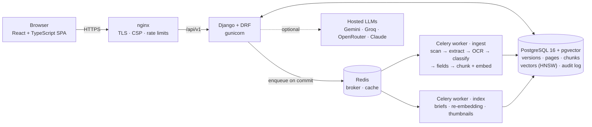
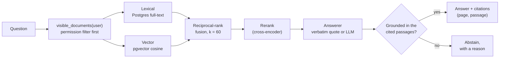
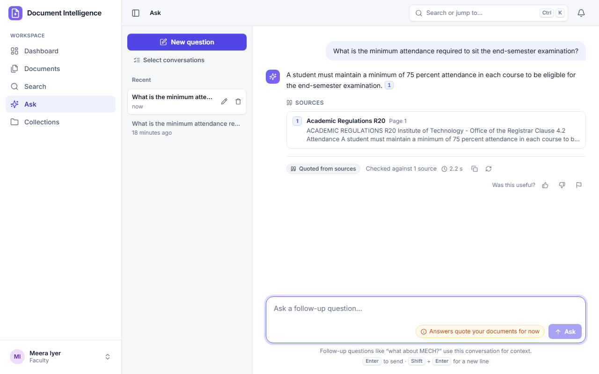
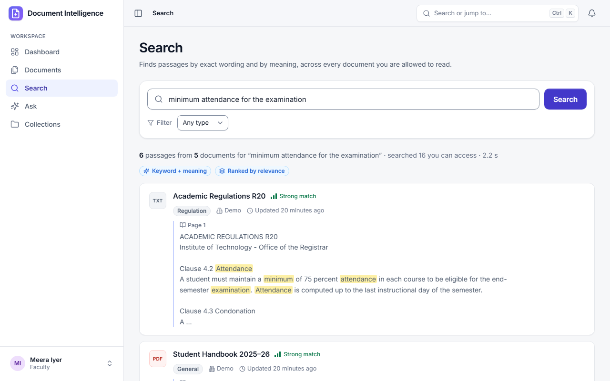
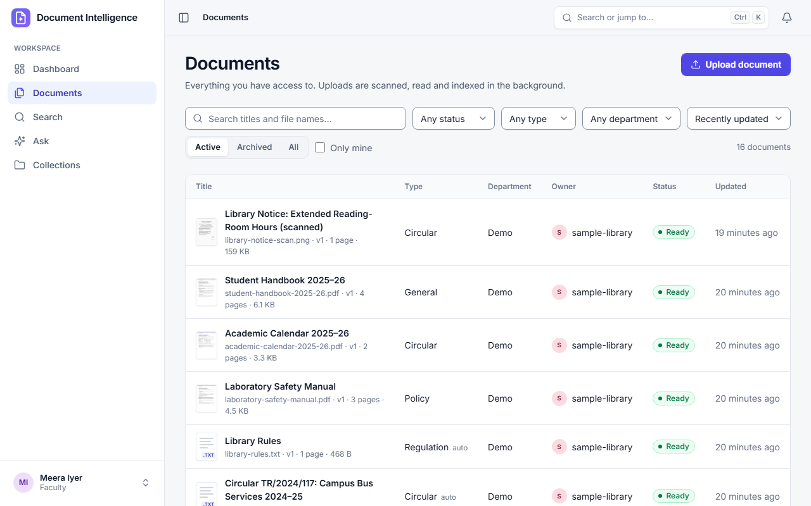

# AI Document Intelligence Platform

[](https://github.com/karrisubhash/ai-document-intelligence/actions/workflows/ci.yml)
**[Live site](https://adi-docs.koreacentral.cloudapp.azure.com)** ·
[Architecture](#architecture) · [Key decisions](#key-engineering-decisions) ·
[Quick start](#quick-start) · [Full documentation](#reference-documentation)

A self-hosted document search and question-answering platform for an institution organised into
departments, such as a college or university. People upload regulations, policies, syllabi,
circulars, forms, spreadsheets, slide decks and scanned pages, in most office formats; a Celery
pipeline extracts the text (with OCR for scans), detects each document's type, pulls out
structured fields and indexes every page. Users then **search everything they are allowed to
see**: PostgreSQL full-text search and, with an embedding model configured, pgvector similarity,
fused by reciprocal-rank fusion and optionally reranked by a cross-encoder. They can also **ask
questions in a chat that answers with numbered citations to the exact page and passage**, or
declines and says why when the documents do not support an answer. Access is scoped to the user's department, and every AI component has an
offline baseline, so the whole system runs without any external AI service.

## Architecture

A modular monolith ([why](#why-one-service)): one Django service, Celery workers on two queues,
PostgreSQL with pgvector as the only database, Redis, and nginx at the edge. Details:
[§3 Architecture](#3-architecture), [§8 Search](#8-search),
[§9 Asking questions](#9-asking-questions-rag-and-chat).



How a question is answered:



## Screenshots

| Ask: a cited answer | Search: retrieved passages | Documents: uploads and status |
|---|---|---|
| [](docs/screenshots/ask-answer.png) | [](docs/screenshots/search-results.png) | [](docs/screenshots/documents.png) |

Captured from a local `docker compose` run of this repository with the bundled sample library
(16 synthetic documents, loaded by `seed_demo`) and the embedding and reranking settings of the
[recommended pilot configuration](#recommended-pilot-configuration): local `bge-small-en-v1.5`
embeddings, the MiniLM cross-encoder, and the default extractive answerer, which quotes the
documents verbatim. Click an image for full size.

## Live demo

**<https://adi-docs.koreacentral.cloudapp.azure.com>** is the public site: the production Compose
stack on one 2 vCPU / 8 GB host since 2026-10-23, with the
[small-server profile](docs/deployment/production.md#small-server-profile), a Let's Encrypt
certificate renewed by certbot, and Gemini's free tier answering questions.

Signing in needs an account. With self-service sign-up on (the default), visitors can request
one from the landing page and an administrator approves it. When the one-click demo is switched
on (`DEMO_ENABLED`), the landing page also offers **Try the live demo**: a read-only guest
account that is deleted after 3 hours
([details](docs/deployment/production.md#the-landing-page-the-public-demo-and-sample-content)).
To see every screen without an account, run it locally with the [quick start](#quick-start).

## Tech stack

| Layer | Technologies |
|---|---|
| Backend | Python 3.12, Django 6.1, Django REST Framework 3.18, Celery 5.6, gunicorn |
| Data | PostgreSQL 16 + pgvector (HNSW index), PostgreSQL full-text search (GIN index), Redis 7 |
| Document AI | pdfplumber + pypdf, Tesseract OCR, python-docx, openpyxl, python-pptx, LibreOffice (old Office formats) |
| Retrieval and ML (optional) | sentence-transformers on CPU PyTorch: `bge-small-en-v1.5` embeddings, MiniLM / `bge-reranker-base` cross-encoders; scikit-learn classifier |
| LLMs (optional) | OpenAI-compatible providers (Gemini, Groq, OpenRouter, Cerebras, Mistral, Ollama, OpenAI) behind one gateway; Claude via the Anthropic API or Amazon Bedrock |
| Frontend | React 19, TypeScript, Vite 6, React Router 7; Vitest + Testing Library; Playwright |
| Infrastructure | Docker Compose, nginx, Let's Encrypt, Prometheus + Grafana, OpenTelemetry (optional), GitHub Actions |

Pinned versions: [§23 Technology stack](#23-technology-stack).

## Key engineering decisions

- **Authorization before similarity.** Search builds its candidate set from
  `visible_documents(user)` before anything is ranked, so search, chat and citations only ever
  rank passages the user could open; there is no "retrieve, then filter" path for a leak to hide
  in. A document the caller may not read returns a 404 identical to a missing id's
  ([§11](#authorization)).
- **Hybrid retrieval fused by rank, not score.** Full-text and pgvector cosine search each
  return up to 50 candidates, merged with reciprocal-rank fusion (k = 60), because a text rank
  and a cosine distance are not on comparable scales. If the query cannot be embedded, search
  continues lexically and says so ([§8](#hybrid-retrieval)).
- **Cross-encoder reranking with calibrated floors.** The top 20 fused candidates are reranked
  and passages under a per-model relevance floor are left out. The small MiniLM cross-encoder was
  chosen over `bge-reranker-base` after measurement: about 10× faster on CPU and a better ranker
  on the synthetic v2 benchmark ([§17](#current-results)).
- **Abstain rather than answer unverified.** Every answer is checked against the passages it
  cites: each `[n]` must resolve, and every number, date and identifier it states must appear in
  a cited passage. A model's answer with unsupported figures is sent back once, told which
  figures it could not support; if any check still fails, the answer becomes an abstention with
  a recorded reason, never an answer with a warning
  ([§9](#grounding-answers-are-verified-not-trusted)).
- **Celery time budgets that follow the document.** Base limits are 900 s soft / 960 s hard; a
  PDF gets 5 s more per page, up to 6 hours, and is re-queued once with the larger limits after
  its page count is read. `acks_late` with a prefetch of 1, a Redis visibility timeout longer than
  any task, and 30-second heartbeats from the OCR and embedding loops let `recover_stalled_jobs`
  reclaim lost jobs without touching slow ones ([§7](#failure-handling)).
- **Idempotent processing and reprocessing.** A retried job deletes what its earlier attempt
  wrote, in the transaction that writes the replacement, so there are no duplicate chunks or
  embeddings. Reprocessing writes a new extraction pass beside the old one and moves
  `DocumentVersion.current_content` to it only once it has its chunks and vectors, so search
  never sees a half-built pass; it answers 409 while a run is active. Uploads accept an
  `Idempotency-Key` ([§12](#conventions)).
- **Offline baselines, visible degradation.** Embeddings, rerankers, answerers, scanners and
  classifiers are selected by a dotted path in settings and sit behind protocols. The default
  install needs no external AI service: its extractive answerer quotes sentences verbatim.
  OpenAI-compatible models are called through one gateway with a daily budget shared in Redis,
  and any hosted-model failure falls back to quoting, with a note on the answer
  ([§9](#the-llm-gateway)).

## Quick start

Needs Docker with Compose v2 and Node 22.

```bash
cp .env.example .env              # set DJANGO_SECRET_KEY and POSTGRES_PASSWORD
docker compose up --build         # db, redis, backend (migrates, serves :8000), worker
docker compose exec backend python manage.py createsuperuser
docker compose exec backend python manage.py seed_demo --department Demo   # optional: 16 sample documents

cd frontend && npm install && npm run dev   # http://localhost:5173, proxied to the API
```

Sign in as the superuser, upload a document or load the samples, then search and ask, for
example *"What is the attendance minimum?"*. Optional AI layers (local embeddings and
cross-encoder, hosted LLMs), running without Docker and Windows notes:
[§5 Getting started](#5-getting-started).

## Testing

| Layer | Runs against | Command |
|---|---|---|
| Backend unit + integration (over 2,000 tests) | Real PostgreSQL + pgvector, Celery eager | `docker compose run --rm -T -e LOG_LEVEL=ERROR backend python manage.py test --noinput` |
| AI workspace | No Django or database | `PYTHONPATH=. python -m unittest discover -s ai/classification/tests -t .` |
| Frontend unit + component | jsdom, mocked API | `cd frontend && npm run typecheck && npm test` |
| Browser end-to-end (Playwright) | A live stack | [§16](#the-browser-suite) |
| Retrieval and answer quality | Synthetic benchmarks vs committed baselines | `python manage.py evaluate … --fail-on-regression` ([§17](#the-regression-gate)) |

CI is a 10-job GitHub Actions workflow: lint, backend and AI tests, frontend, end-to-end,
security checks, the AI regression gate and the image build, plus three deploy jobs that are
still placeholders ([§21](#21-cicd)). Regression tests are written to fail without their fix.

## Reference documentation

Everything below is the full technical reference. **New here?** Read sections
[1](#1-what-the-platform-does) to [4](#4-repository-map), about 20 minutes. Then
[run it](#5-getting-started). The rest is a reference: use the contents list to find what you
need.

Every AI component is pluggable and has an offline baseline. That covers OCR, classification,
field extraction, embeddings, reranking and answering. The whole system therefore runs with no
external AI service. Two optional hosted layers sit on top and fall back to that baseline: answers
written by a chain of language-model providers, and figures read by a vision model.

Two other places help. [`docs/`](docs/README.md) has a deeper page on each topic.
[docs/architecture/design-history.md](docs/architecture/design-history.md) records *why* things
are the way they are, and the defects and measurements behind each decision.

### Contents

1. [What the platform does](#1-what-the-platform-does)
2. [Status at a glance](#2-status-at-a-glance)
3. [Architecture](#3-architecture)
4. [Repository map](#4-repository-map)
5. [Getting started](#5-getting-started)
6. [Core concepts and data model](#6-core-concepts-and-data-model)
7. [Document processing pipeline](#7-document-processing-pipeline)
8. [Search](#8-search)
9. [Asking questions: RAG and chat](#9-asking-questions-rag-and-chat)
10. [Collections](#10-collections)
11. [Security model](#11-security-model)
12. [API](#12-api)
13. [Web application](#13-web-application)
14. [Configuration reference](#14-configuration-reference)
15. [Management commands](#15-management-commands)
16. [Testing](#16-testing)
17. [Evaluation](#17-evaluation)
18. [Observability](#18-observability)
19. [Production deployment](#19-production-deployment)
20. [Operations and troubleshooting](#20-operations-and-troubleshooting)
21. [CI/CD](#21-cicd)
22. [AI workspace](#22-ai-workspace)
23. [Technology stack](#23-technology-stack)
24. [Project history](#24-project-history)
25. [Known limitations and open decisions](#25-known-limitations-and-open-decisions)
26. [Working on this codebase](#26-working-on-this-codebase)
27. [Further reading](#27-further-reading)

---

## 1. What the platform does

### Who uses it

The users are staff, faculty and students, plus department administrators and system
administrators. **The department is the tenant boundary.** A person sees their own department's
documents and their own uploads, and nothing else unless they are a system administrator.

### What a user can do

- **Upload** files of up to 50 MB each: one file, several at once, or a `.zip` of them. The web
  application opens a `.zip` in the browser and uploads each file inside as its own document.
  - Formats: PDF; Word (DOCX, and the old DOC); Excel (XLSX, the old XLS) and CSV/TSV;
    PowerPoint (PPTX, the old PPT); OpenDocument (ODT, ODS, ODP); RTF; HTML; JSON and XML;
    plain text and Markdown; and images (PNG, JPEG, TIFF, WebP, BMP). The old Office formats
    are converted by LibreOffice, which the image includes unless it is built without it.
  - Processing runs in the background. The document page shows each stage as it runs, and a
    notification says when the document is ready or has failed.
- **Read what was extracted** from each document:
  - a brief: summary sentences, key points, dates and deadlines, and suggested questions, each
    pointing at its page and passage; a first-page thumbnail (PDFs and images); related
    documents;
  - page text, with OCR'd pages flagged. Tables are written into the text as labelled rows
    (`Table 2, row 1: Course Code: 23CS101; ...`). Charts and diagrams can be read by an
    optional vision model;
  - structured fields, such as a circular's number and issue date;
  - the detected document type and the classifier's verdict;
  - every version ever uploaded.
- **Search** every document they may read.
  - Keyword and semantic search are combined.
  - Each hit opens the document at the exact passage.
- **Ask questions** in a chat.
  - Answers cite numbered sources. Each source opens the cited passage, highlighted on its page.
  - Follow-ups ("what about MECH?") and multi-part questions work. A model writing the answer is
    shown the last exchanges of the conversation.
  - Questions about the library itself ("What documents are uploaded?", "Summary of the recently
    uploaded document") are answered from the list of documents the asker can read and their
    briefs, with citations and no model call.
  - When the documents do not answer, the system says so and says why.
  - With a generative model configured, answers stream in as they are written, and each answer
    names the model that wrote it. When no model is available the answer is quoted from the
    documents instead. General-knowledge replies can be switched on as well; they are clearly
    labelled.
- **Group documents into collections**, and scope search or chat to one collection.
- **Delete in bulk**: tick documents, conversations or collections, or take everything that
  matches the current filter.
- **Find their way around**: a dashboard with recent activity and upcoming deadlines read from
  the documents, a notification bell, and a command palette (Ctrl+K).
- **Request an account** from the sign-in page, when self-service sign-up is on. An administrator
  approves each request.
- **Administer the platform** (administrators only): accounts and sign-up requests, departments,
  the processing queue (including retrying failed runs), the audit log, analytics, and system
  health, including the state of each AI provider.

### The capability chain

```
seeing  →  understanding  →  extracting  →  searching  →  reasoning  →  answering  →  evaluating
OCR,       classification    fields,        hybrid         follow-ups,   grounded,      benchmarks,
parsing                      tables         retrieval      planning      cited          regression gate
```

### Rules the system does not break

These rules explain most of the design choices you will meet in the code.

1. **Never fabricate.** The system skips, abstains or fails honestly instead:
   - a capability that is not configured records `SKIPPED`;
   - a field that is not in the document is `NOT_FOUND`;
   - an answer that cannot be verified against its sources becomes an abstention.

   A confident wrong output is treated as worse than no output.
2. **Authorization comes before similarity.** Search and chat only ever rank passages the user
   could open directly. There is no "retrieve, then filter" path for a leak to hide in.
3. **Documents are data, never instructions.**
   - Text that reaches a language model is fenced off as data.
   - Instruction-like passages are flagged and never quoted as answers.
   - Every generated claim is checked against the passages it cites.
4. **Measure, don't assume.** Thresholds, architecture and defaults change when a measurement
   says so. The documentation labels every claim as verified or unverified.
5. **Keep the evidence.**
   - Versions are immutable.
   - Reprocessing writes a new extraction pass beside the old one.
   - Every stage writes an event.
   - Every access is audited, including refusals.

### Where it came from

The platform was built against an enterprise specification, *AI Document Intelligence Platform —
Enterprise-Level Technical Documentation v1.0*. The specification is not committed to the
repository. References such as §12 or FR-14 point into it.
[docs/architecture/spec-traceability.md](docs/architecture/spec-traceability.md) maps every
requirement to the code and tests that implement it, and lists where the implementation
deliberately differs from the specification.

---

## 2. Status at a glance

As of 2026-11-25.

| Area | State |
|---|---|
| **Code** | Complete for a **single-host pilot**. Every functional requirement of the specification is implemented or deliberately adapted ([traceability](docs/architecture/spec-traceability.md)) |
| **Backend tests** | Over 2,000 tests ([AI release readiness](docs/release/ai-release.md), 2026-11-15), run against real PostgreSQL + pgvector. How to run them: [docs/development/testing.md](docs/development/testing.md) |
| **Frontend tests** | Unit and component tests (Vitest). Playwright browser specs against a live stack: the whole product, the Content-Security-Policy, deleting by selection, and uploading several files and a zip. The browser suite as it stood on the release candidate passed **8/8 through nginx over TLS** (2026-10-06) |
| **AI quality** | Measured on **synthetic** benchmarks only. On the 57-question v2 benchmark, the recommended configuration ranks the right document first for 98% of answerable questions. With the default extractive answerer it answers only about half of them, because quoting declines paraphrased questions. The 32-question v3 benchmark asks the way people ask and scores whether answers are right. **Nothing has been measured on real institutional documents** |
| **Generative answers** | Built: an LLM gateway that walks a chain of providers (`RAG_ANSWERER_CHAIN`, for example `gemini,groq,openrouter`) with daily limits shared by every process. Presets for Gemini, Groq, OpenRouter, Cerebras, Mistral, Ollama and OpenAI; Claude through the Anthropic API or Amazon Bedrock. Gemini's free tier has answered on a public demonstration site since 2026-10; the Groq and OpenRouter presets were each called with a real key on 2026-11-15; the rest are contract-tested with stub clients only |
| **Figures** | Charts stored in Office files are read exactly; other charts and diagrams by an optional vision model. Measured on synthetic charts and flowcharts only ([docs/ai/figures.md](docs/ai/figures.md)) |
| **CI** | A 10-job GitHub Actions workflow. The repository has a GitHub remote, and the workflow runs there on pushes to `main` and `master` and on pull requests. The deploy jobs are placeholders |
| **Production** | The production compose stack is verified locally: TLS with a self-signed certificate, the browser suite through nginx, and backup, restore and rollback rehearsed. A public site has run on one 2 vCPU / 8 GB host since 2026-10-23 ([small-server profile](docs/deployment/production.md#small-server-profile)), with a Let's Encrypt certificate issued and renewed by the certbot service |
| **Go-live blockers** | None known in the code. The rest is institutional decisions; see [§25](#25-known-limitations-and-open-decisions) |

**Repository state**

- The current code is on `main` in the GitHub remote. `master` is an old branch, far behind;
  ignore it.

The full picture of what is verified and what is not is in
[docs/release/RELEASE_READINESS.md](docs/release/RELEASE_READINESS.md).

---

## 3. Architecture

This is a **modular monolith**:

- one Django service with explicit internal boundaries;
- one Celery worker pool split across two queues;
- PostgreSQL (with pgvector) as the only database;
- Redis as broker and cache;
- nginx at the edge, serving the compiled frontend.

### Production topology

```
Browser ── HTTPS ──► nginx (edge image: TLS, CSP, rate limits)
                       ├── /  and /assets/      React SPA, compiled into the image
                       ├── /api/  /django-admin/  /health/  /ready/  ──►  gunicorn (Django + DRF)
                       └── /metrics             404 at the edge; Prometheus scrapes internally
                                                                 │
          ┌──────────────────────────────────────────────────────┼─────────────────────────┐
          ▼                                                      ▼                         ▼
  PostgreSQL 16 + pgvector                              Redis 7                    Media storage
  documents, versions, pages, fields,                   Celery broker, cache,      local volume or an
  chunks + vectors, briefs, conversations,              sessions, throttle         S3-compatible bucket
  notifications, audit log, evaluation runs             counters, idempotency keys,
                                                        LLM call counts
          ▲                                                      │
          │                                                      ▼
          └───────────── writes ──────────────  Celery workers
                                                  queue "ingest": the processing pipeline   (worker)
                                                  queue "index":  re-embedding, briefs       (worker-index)

  Prometheus scrapes backend:8000/metrics and the workers on :9100.
  Grafana listens on 127.0.0.1:3000 only.
```

In development, `docker compose up` runs the same pieces without nginx:

- `runserver` on `:8000`;
- one worker serving both queues;
- the Vite dev server on `:5173`, which proxies `/api` to the backend.

### The three request paths

**1. Upload → processing.**

```
POST /api/v1/documents/   (multipart: title, document_type, file)
  → uploads.validate_upload        size ≤ 50 MB, supported extension, not empty — BEFORE storing anything
  → services.create_document_version
                                   Document + immutable DocumentVersion (row-locked numbering, SHA-256)
  → ProcessingJob(QUEUED), enqueued on the "ingest" queue when the transaction commits
  ← 202 Accepted
worker: tasks.process_document_task → processing/pipeline.run_pipeline
  (a PDF first re-queues itself once, with time limits sized to its page count)
  INGESTION → SCANNING → VALIDATION → TEXT_EXTRACTION → OCR → LAYOUT_ANALYSIS
  → persist DocumentContent + PageContent + figures   (one transaction; tables are rows in the page text)
  → CLASSIFICATION → EXTRACTION → INDEXING (chunks + embeddings)
  → publish: DocumentVersion.current_content now points at this pass
  → queue enrichment on "index": brief, entities, related-documents centroid, thumbnail
```

Several files, or a `.zip`, are this same request once per file: the web application opens a
`.zip` in the browser, and the server never parses an uploaded archive.

**2. Search.**

```
POST /api/v1/search/ {query}
  → authorization.visible_documents(user)        computed FIRST
  → restrict: current version, live extraction pass, not archived, optional filters
  → lexical (PostgreSQL tsvector)  ‖  vector (pgvector cosine, HNSW)
  → reciprocal-rank fusion
  → search/ranking.py: with a cross-encoder, rerank the top 20 and leave weak passages off the page
  → ranked chunks with page and character span
```

**3. Ask.**

```
POST /api/v1/chat/  or  /api/v1/chat/stream/ (Server-Sent Events)
  → follow-up resolution (borrows terms from the user's own earlier questions)
  → planning (only when the answer will be quoted: a question with 3+ parts is split)
  → for each part: search → rerank → relevance (a score floor, or the model judges)
    → context (+ the conversation so far, for a model) → answerer (via the LLM gateway) → grounding
  → answer + citations, or an abstention with a reason
    (or a labelled general-knowledge reply, if that is enabled)
```

### Boundaries that matter

- **One set of access rules.** They live in [`documents/authorization.py`](backend/documents/authorization.py)
  as plain functions. Every path calls them: list, detail, every sub-resource, search, chat,
  citations, the dashboard, audit, jobs and evaluations.
- **One live extraction pass per version.** Reprocessing writes a new pass beside the old one.
  `DocumentVersion.current_content` decides which pass search answers from, and it is switched
  in the same transaction that writes the pass.
- **Replaceable providers.**
  - Embedding providers, rerankers, answerers, scanners, classifiers, the document-type
    detector, field extractors and the table and figure detectors are each named by a dotted
    path in settings.
  - Each one sits behind a protocol.
  - Each degrades *visibly* to the bundled baseline when its backend is unavailable.
- **One gateway for every model call.** [`rag/gateway.py`](backend/documents/rag/gateway.py)
  chooses the provider link, keeps cooldowns and each day's call counts in Redis so every
  process agrees, and holds a reserve of the day's calls back for chat. The Claude answerer is
  the exception: it calls its own SDK.
- **The `ai/` training workspace imports no Django**, and Django imports nothing from it. The
  only hand-off is a versioned model artifact.

### Why one service

The specification sketched separate FastAPI AI services and an API gateway. They were not built,
because nothing measured needs them:

- the AI components run in-process or are thin clients of hosted APIs;
- CPU-heavy work already runs in workers that scale independently (the `ingest` and `index`
  queues);
- one codebase is how the authorization rules are guaranteed to be identical on every path.

What would change this decision is a shared GPU inference service, or enough model-memory
pressure that API processes should not hold the models. Details are in
[docs/architecture/overview.md](docs/architecture/overview.md#why-one-service).

---

## 4. Repository map

```
ai-document-intelligence/
├── backend/                          Django project: the API and the pipeline (one service)
│   ├── config/                       settings.py (ALL configuration), urls.py, celery.py, health.py, wsgi.py
│   ├── gunicorn.conf.py              multiprocess-metrics and model warm-up hooks
│   ├── requirements.txt              base dependencies
│   ├── requirements-{ml,local,llm,s3,otel}.txt   optional layers, chosen by build args
│   ├── constraints.txt               exact pins for every install (image and CI)
│   ├── accounts/                     Department registry, UserProfile + roles, session and token
│   │                                 auth, self-service sign-up, the one-click demo,
│   │                                 administration API (users, departments, sign-up requests)
│   ├── notifications/                the bell and the administrators' attention badges
│   └── documents/
│       ├── models/                   every domain model, one file per area
│       ├── api/                      documents REST API (viewset, serializers, discovery filters,
│       │                             briefs and related documents)
│       ├── processing/               the pipeline
│       │   ├── pipeline.py           stage orchestration, persistence, publishing the live pass
│       │   ├── stages/               one module per stage
│       │   ├── extractors/           pdf (pdfplumber; pypdf fallback), docx, spreadsheet (openpyxl,
│       │   │                         csv), presentation (python-pptx), opendocument, rtf, webpage
│       │   │                         (HTML), structured (JSON, XML), legacy (LibreOffice), charts,
│       │   │                         ocr (Tesseract), page geometry, plain text
│       │   ├── scanning/             scanner protocol + heuristic scanner
│       │   ├── tables/  figures/     layout analysis; tables/text_rows.py writes a table as
│       │   │                         labelled rows, figures/vision.py reads figures with a model
│       │   ├── classification/       classifier protocol, institutional type detector,
│       │   │                         trained text-classifier adapter
│       │   ├── field_extraction/     schema packs (JSON) + rule-based extractor
│       │   ├── chunking/             page-bounded splitter, indexing service
│       │   ├── embedding/            hashing baseline, local sentence-transformers, Bedrock Titan
│       │   ├── insights/             briefs, entities, related documents, thumbnails
│       │   ├── limits.py             task time limits sized to a PDF's page count
│       │   ├── heartbeat.py          progress reports from long OCR and embedding loops
│       │   ├── errors.py             ErrorCode, StageError, TransientError
│       │   └── warmup.py, model_cache.py   offline-first model loading
│       ├── search/                   hybrid retrieval, Search-page ranking + /search/
│       ├── rag/                      engine, reranking, context, answerers, the LLM gateway,
│       │                             grounding, quoting, follow-ups, conversation history,
│       │                             sections and abbreviations, general-knowledge replies,
│       │                             streaming
│       ├── agents/                   multi-part question planner and runner
│       ├── chat/                     chat, streaming and conversation endpoints
│       ├── collections/              collection endpoints
│       ├── samples/                  the sample library, for the demo and empty installations
│       ├── evaluation/               benchmark loader, metrics, runner, regression comparison
│       ├── evaluation_api/           read-only evaluation API + answer feedback
│       ├── operations/               audit log, processing monitor, system status, AI providers,
│       │                             analytics, dashboard, health
│       ├── observability/            JSON logging with redaction, Prometheus metrics, tracing
│       ├── benchmarks/               extraction benchmark harness
│       ├── management/commands/      backup, restore, reindex, evaluate, seed_*, …  (§15)
│       ├── authorization.py          THE access rules, as plain functions
│       ├── permissions.py            DRF policy: 404 to non-readers, 403 to non-managers, audit both
│       ├── services.py               versions, enqueue, reprocess, archive, retry, stalled-job recovery
│       ├── uploads.py                upload admission, before anything is stored
│       ├── idempotency.py            Idempotency-Key handling for uploads
│       ├── storage.py                storage-agnostic local copy for the pipeline (S3 support)
│       ├── tasks.py, tasks_reindex.py, tasks_insights.py   Celery tasks and retry policy
│       ├── audit.py, throttling.py, signals.py
│       └── tests*.py                 the backend test suite, one file per capability
├── frontend/                         React 19 + Vite + TypeScript web application
│   ├── src/api/                      typed client (CSRF, upload progress, SSE chat stream), hooks
│   ├── src/auth/                     session state and capability checks
│   ├── src/components/               layout, UI primitives, upload dialog, command palette,
│   │                                 notification bell, charts/, chat/, dashboard/ and document/ panels
│   ├── src/lib/                      formatting, labels, highlighting, safe Markdown renderer,
│   │                                 in-browser zip reader, theme
│   ├── src/pages/                    one file per screen; admin/ for administration
│   ├── src/styles.css, src/styles/   design tokens and stylesheets
│   └── e2e/                          Playwright specs (they need a live stack)
├── ai/                               offline classifier training and evaluation; imports no Django
│   ├── common/                       download and Kaggle API helpers
│   └── classification/               datasets, preprocessing, training, evaluation, configs, tests
├── evaluation/                       synthetic corpus, governed benchmark templates, committed baselines
├── infrastructure/
│   ├── nginx/                        edge image: builds the SPA; TLS, CSP, rate limits, proxy
│   ├── prometheus/                   scrape configuration + 14 alert rules
│   ├── grafana/                      provisioned datasource + "AI Document Intelligence" dashboard
│   ├── init-letsencrypt.sh           obtains the first TLS certificate
│   └── check_deployment_config.py    asserts the merged production compose is safe
├── docs/                             the working reference (index: docs/README.md)
├── .github/workflows/ci.yml          10-job CI pipeline
├── Dockerfile                        backend/worker image (python:3.12-slim, runs as uid 10001)
├── docker-compose.yml                development stack
├── docker-compose.prod.yml           production overlay (never loaded automatically)
├── docker-compose.small.yml          sizing for a 2 vCPU / 8 GB host, on top of the overlay
├── .env.example                      environment variables, with comments
└── pyproject.toml                    ruff configuration
```

Git-ignored local data you may see includes:

- `backend/media/`, `backend/db.sqlite3` (unused; the database is PostgreSQL) and `backups/`;
- `ai/classification/{data,artifacts,runs}/`;
- the resolved `evaluation/benchmark*.json` files.

### Where to start reading

| To understand… | Start with |
|---|---|
| Who may see what | [`documents/authorization.py`](backend/documents/authorization.py), then [`documents/permissions.py`](backend/documents/permissions.py) and [`accounts/permissions.py`](backend/accounts/permissions.py) |
| What happens after an upload | `DocumentViewSet.create` in [`documents/api/views.py`](backend/documents/api/views.py) → [`services.py`](backend/documents/services.py) → [`tasks.py`](backend/documents/tasks.py) → [`processing/pipeline.py`](backend/documents/processing/pipeline.py) |
| How a file becomes page text | [`processing/stages/text_extraction.py`](backend/documents/processing/stages/text_extraction.py) → [`processing/extractors/`](backend/documents/processing/extractors/) → [`processing/stages/layout_analysis.py`](backend/documents/processing/stages/layout_analysis.py) → [`processing/tables/text_rows.py`](backend/documents/processing/tables/text_rows.py) |
| How a question is answered | [`chat/views.py`](backend/documents/chat/views.py) → [`agents/runner.py`](backend/documents/agents/runner.py) → [`rag/engine.py`](backend/documents/rag/engine.py) (`ask`) → [`search/service.py`](backend/documents/search/service.py) → [`rag/grounding.py`](backend/documents/rag/grounding.py) |
| How a language model is called | [`rag/gateway.py`](backend/documents/rag/gateway.py), [`rag/providers.py`](backend/documents/rag/providers.py) and [docs/ai/llm-providers.md](docs/ai/llm-providers.md) |
| Every setting and its default | [`config/settings.py`](backend/config/settings.py), the single source of truth, heavily commented; also [§14](#14-configuration-reference) |
| How the UI talks to the API | [`frontend/src/api/client.ts`](frontend/src/api/client.ts) |
| The production topology | [`docker-compose.prod.yml`](docker-compose.prod.yml) and [`infrastructure/nginx/nginx.conf`](infrastructure/nginx/nginx.conf) |

---

## 5. Getting started

### Prerequisites

- **Docker** with Compose v2. The backend, worker, PostgreSQL and Redis run in containers. The
  image carries Tesseract and poppler for OCR, and LibreOffice (Writer, Calc and Impress, without
  their GUI) for the old Office formats.
- **Node 22**, for the frontend dev server. Alternatively, run it in a container (see below).
- **Python 3.12**, only if you want to run `ruff` or the AI workspace on the host, or run without
  Docker.

### First run

```bash
cp .env.example .env
# Edit .env: set DJANGO_SECRET_KEY and POSTGRES_PASSWORD; keep APP_PORT=8000.
docker compose up --build        # db, redis, backend (migrates, then runserver on :8000), worker
docker compose exec backend python manage.py createsuperuser

cd frontend
npm install
npm run dev                      # http://localhost:5173, proxied to the API on :8000
```

To run the frontend in a container instead of on the host: `docker compose --profile frontend up`.

Then:

1. Sign in at <http://localhost:5173> as the superuser. A superuser is a `SYSTEM_ADMIN`.
2. Go to **Administration → Departments** and create the departments. Departments are a
   registry, so a typo cannot create a tenant.
3. Go to **Administration → Users** and create accounts in those departments.
4. Upload a document and watch its processing timeline. The synthetic documents in
   [`evaluation/corpus/`](evaluation/corpus/) are good test material, and
   `docker compose exec backend python manage.py seed_demo --department <name>` loads the
   bundled sample library into a department.
5. Search, and ask a question such as *"What is the attendance minimum?"*

Health checks: `curl http://localhost:8000/health/` and `curl http://localhost:8000/ready/`.

> **If chat answers carry a note that the generative answerer fell back:** your `.env` names a
> hosted answerer (for example the Gemini block in `.env.example`) without a key, or the image was
> built without `INSTALL_LLM=true`. Answers are then extractive, which is the safe default. Either
> supply the key and rebuild, or remove `RAG_ANSWERER` from `.env`.

### What is on by default

With nothing configured, the system runs fully offline:

| Capability | Default |
|---|---|
| Text extraction for every supported format, OCR, tables written as labelled rows, figure location | **On** |
| Institutional document-type detection, field extraction (the bundled rule extractor), briefs and thumbnails | **On.** CPU only; no model, key or download |
| Old `.doc`, `.xls` and `.ppt` files | **On** in the default image, which includes LibreOffice |
| Reading figures with a vision model | **On only when a key is set** for a model in `FIGURE_DESCRIBER_CHAIN` (by default Groq, then Gemini) and the image has the LLM layer (`INSTALL_LLM=true`). Without a key, no picture leaves the server |
| Malware scanning | **Off.** The stage records `SKIPPED` |
| The trained layout classifier | **Off.** Only the type detector runs in the classification stage |
| Search | **Lexical only.** Chunks are indexed but not embedded until an embedding provider is set |
| Reranking | Lexical reranker |
| Answering | **Extractive.** Quotes sentences verbatim and cannot hallucinate. Nothing is generated or streamed |

### Turning on the optional AI layers

Heavier dependencies are opt-in **image build arguments**. Set them in `.env` or in the shell:

| Build argument | Installs | Enables |
|---|---|---|
| `INSTALL_ML=true` | scikit-learn, joblib | the trained text classifier |
| `INSTALL_LOCAL=true` | CPU PyTorch, sentence-transformers | local semantic embeddings and cross-encoder reranking |
| `INSTALL_LLM=true` | anthropic, boto3, openai | Claude (Anthropic API or Bedrock) and OpenAI-compatible answerers; figure reading; Bedrock embeddings and reranking |
| `INSTALL_S3=true` | django-storages, boto3 | S3-compatible object storage (passed only by the production overlay) |
| `INSTALL_OTEL=true` | OpenTelemetry SDK and instrumentation | distributed tracing |
| `LEGACY_OFFICE=0` | (leaves LibreOffice out) | a smaller image; `.doc`, `.xls` and `.ppt` then fail with a message asking for the modern format. Default `1` |
| `TESSERACT_LANGS="hin tel"` | `tesseract-ocr-<code>` packages | OCR in more languages, selected with `OCR_LANGUAGES` |

```bash
INSTALL_LOCAL=true INSTALL_ML=true docker compose up --build
docker compose build --build-arg TESSERACT_LANGS="hin"     # LEGACY_OFFICE and TESSERACT_LANGS: build args only, not read from .env
```

Then select the capabilities in `.env`:

```bash
# Semantic search and cross-encoder reranking (local CPU models)
DOCUMENT_EMBEDDING_PROVIDER=documents.processing.embedding.local.LocalEmbeddingProvider
RAG_RERANKER=documents.rag.local_rerank.LocalCrossEncoderReranker
RAG_RERANKER_LOCAL_MODEL=cross-encoder/ms-marco-MiniLM-L6-v2   # recommended on CPU (see §17)

# Pipeline capabilities (field extraction and type detection are already on)
DOCUMENT_SCANNER=documents.processing.scanning.heuristic.HeuristicScanner
DOCUMENT_CLASSIFIER=documents.processing.classification.text_classifier.TextDocumentClassifier  # needs INSTALL_ML
```

After changing the embedding provider, run these once:

```bash
docker compose exec backend python manage.py warm_models   # download the model weights into the hf_cache volume
docker compose exec backend python manage.py reindex       # re-embed existing documents
```

**Generative, streamed chat (optional).** Build with `INSTALL_LLM=true`, then choose providers:

```bash
# A chain of free tiers through the OpenAI-compatible answerer: Gemini first, then Groq, then
# OpenRouter. Each link adds its own daily allowance; a link without a key is skipped.
RAG_ANSWERER=documents.rag.openai_compat.OpenAICompatibleAnswerer
RAG_ANSWERER_CHAIN=gemini,groq,openrouter
GEMINI_API_KEY=...                      # from https://aistudio.google.com/apikey
GROQ_API_KEY=...                        # from console.groq.com/keys
OPENROUTER_API_KEY=...                  # from openrouter.ai/keys
CHAT_GENERAL_KNOWLEDGE=True             # optional: labelled, uncited replies when the documents have nothing

# …or a single provider, with that provider's own fallback models
RAG_ANSWERER_PROVIDER=gemini            # or groq, openrouter, mistral, cerebras, ollama, openai

# …or Claude
RAG_ANSWERER=documents.rag.claude.ClaudeAnswerer
ANTHROPIC_API_KEY=...                   # or RAG_ANSWERER_BACKEND=bedrock + AWS_BEDROCK_REGION
```

A key set for chat also turns on figure reading when its provider is in
`FIGURE_DESCRIBER_CHAIN` (Groq and Gemini by default). **System status → AI providers** shows
each link's state and today's calls, and can send a link a test request. Limits, data use and
the full chain syntax are in [docs/ai/llm-providers.md](docs/ai/llm-providers.md).

> **Data protection.** With a hosted answerer, retrieved document text is sent to that provider;
> with figure reading on, the pictures are sent to the describer's provider. Free tiers (Gemini,
> OpenRouter) may use what is sent to improve their products. Do not use them with confidential
> documents. Whether any hosted provider may receive document text is an institutional decision
> ([§25](#25-known-limitations-and-open-decisions)).

### Recommended pilot configuration

This is the configuration verified end to end on the release candidate:

- local `bge-small-en-v1.5` embeddings;
- the **MiniLM** cross-encoder, which is about 10× faster than `bge-reranker-base` on CPU and
  ranked better on the benchmark;
- the heuristic scanner;
- rule-based field extraction (now on by default);
- the extractive answerer;
- `HF_HUB_OFFLINE=1` after `warm_models`, so nothing contacts the model hub at runtime.

The trained classifier is optional. Its classes are business-document types from RVL-CDIP, not
institutional ones (see [§22](#22-ai-workspace)).

### Running without Docker

You need Python 3.12, PostgreSQL with pgvector, and Redis, plus `poppler` and `tesseract` on
`PATH`. LibreOffice (`soffice` on `PATH`, or `LIBREOFFICE_PATH`) is needed only for `.doc`, `.xls`
and `.ppt` files.

```bash
python -m venv backend/venv
source backend/venv/Scripts/activate        # Windows Git Bash; bin/activate elsewhere
pip install -r backend/requirements.txt -c backend/constraints.txt
cp .env.example .env    # set POSTGRES_HOST=localhost, REDIS_HOST=localhost,
                        # CELERY_BROKER_URL=redis://localhost:6379/0, CELERY_RESULT_BACKEND=redis://localhost:6379/1
cd backend
python manage.py migrate
python manage.py runserver
# second shell:
celery -A config worker --loglevel=INFO --queues=ingest,index
```

### Everyday commands

```bash
docker compose run --rm -T -e LOG_LEVEL=ERROR backend python manage.py test --noinput   # backend suite
docker compose exec backend python manage.py makemigrations                            # after a model change
backend/venv/Scripts/ruff.exe check backend ai                                          # lint (ruff 0.16.8)
backend/venv/Scripts/ruff.exe format backend ai                                         # format
cd frontend && npm run typecheck && npm test && npm run build                           # frontend checks
```

### Windows notes

This project was developed on Windows with Git Bash and Docker Desktop.

- **Git Bash rewrites container paths.** It turns `/app/x` into `C:/Program Files/Git/app/x`.
  Prefix such `docker compose run …` commands with `MSYS_NO_PATHCONV=1`.
- **Shell scripts must stay LF.** `.gitattributes` enforces `*.sh eol=lf`. A CRLF entrypoint
  makes the nginx image exit with code 127.
- **Don't run the Django test runner with `--parallel`.** One test error is not picklable, so the
  parallel runner hides the real failure behind a pickling traceback.
- **A stopped `npx vite` can keep its port.** Check for a lingering node process if `:5173` is
  busy.

---

## 6. Core concepts and data model

### Glossary

| Term | Meaning |
|---|---|
| **Department** | The tenant boundary. A registry of names (`accounts.Department`). Documents, profiles, collections and conversations store the department name |
| **Role** | One of `SYSTEM_ADMIN`, `DEPARTMENT_ADMIN`, `FACULTY`, `STAFF`, `STUDENT` (`accounts.UserProfile`). New accounts default to `STUDENT`; a Django superuser is given `SYSTEM_ADMIN` |
| **Capability** | A flag derived from the role, such as `administer_users`, returned by `/api/v1/auth/me/`. The UI uses capabilities to decide what to show. The API enforces the same rules independently |
| **Sign-up request** | A request for an account made from the sign-in page (`accounts.SignupRequest`). It is not an account; an administrator's approval creates one |
| **Demo guest** | A temporary, read-only account made for one visitor by the one-click demo (`UserProfile.is_guest`), when the demo is on |
| **Document** | The logical document: title, type (and whether a person or the type detector set it), department, owner, status, current version, and optionally an archive date |
| **Version** | An immutable uploaded file with a SHA-256 checksum. Uploading again creates a new version |
| **Processing job / event** | A job is one pipeline run over one version. An event records one stage's outcome within that run |
| **Extraction pass** | A `DocumentContent` row: the per-page text produced by one run. Reprocessing creates another pass. `DocumentVersion.current_content` is the live one |
| **Table row** | One line of page text a table was written as: `Table 2, row 1: Course Code: 23CS101; Credits: 4`. Tables are not stored as grids |
| **Brief** | What enrichment computes after a document is published: summary sentences, key points, entities, dates and suggested questions, each with its page and span (`DocumentInsight`, `DocumentEntity`). Extractive; no language model |
| **Chunk** | A span of one page's text: the unit of retrieval and citation. A chunk never crosses a page boundary |
| **Embedding** | One model's 384-dimensional vector for one chunk. Its model name and version are stored with it |
| **Collection** | A named set of documents within one department. It narrows search and chat; it never grants access |
| **Citation** | Document, page, chunk, character span and quoted text. It resolves back to exact words |
| **Abstention** | A deliberate *"I couldn't find enough information in the provided documents."*, with a recorded reason |
| **Grounding** | The checks every answer must pass against the passages it cites |
| **Provider** | A pluggable implementation (embedder, reranker, answerer, scanner, …) selected by a dotted path in settings |
| **Chain link** | One `provider:model` pair the LLM gateway may send a request to, such as `groq:openai/gpt-oss-120b`. Links are tried in order |

### Models

**`accounts` app**

| Model | Purpose |
|---|---|
| `Department` | Registry of tenant names: `name` (unique), `code`, `description`, `is_active`. There is no delete; departments are deactivated |
| `UserProfile` | One-to-one with Django's `User`. Holds `role`, `department`, and `is_guest` for demo guests |
| `SignupRequest` | A waiting, approved or declined request for an account: username, email, name, the department and role asked for, a password hash until it is decided, and the decision |

**`notifications` app**

| Model | Purpose |
|---|---|
| `Notification` | One item in a person's bell: `kind`, `title`, `body`, an in-app `url`, `read_at`. A batch upload's results fold into one notification |

**`documents` app** (`backend/documents/models/`)

| Model | Purpose and key fields |
|---|---|
| `Document` | `title`, `document_type` (`GENERAL`, `REGULATION`, `POLICY`, `SYLLABUS`, `CIRCULAR`, `FORM`, `OTHER`), `document_type_source` (`default`, `auto`, `user`) and `type_confidence`, `department`, `owner`, `current_version`, `status`, `archived_at` / `archived_by` |
| `DocumentVersion` | `version_number`, `file`, `file_name`, `file_size`, `mime_type`, `checksum`, `current_content` (the live pass), `uploaded_by` |
| `ProcessingJob` | One run: `status`, `current_stage`, `attempt`, `error_code`, `error_message`, timestamps |
| `ProcessingEvent` | One stage attempt: `stage`, `status` (`STARTED`, `SUCCEEDED`, `SKIPPED`, `FAILED`), `message`, `metadata` (duration, error code, findings) |
| `DocumentContent` / `PageContent` | One extraction pass (with its `processing_version`), and its pages. Each page has `text`, `extraction_method` (`PDF_TEXT`, `OCR`, `PLAIN_TEXT`, `DOCX_TEXT`, `SPREADSHEET`, `PRESENTATION`) and `character_count`. A sheet or a slide is a page |
| `DocumentFigure` | Located figures (page, size). `description` holds what a vision model read, and `description_source` names it; both are empty for a figure that was not read |
| `DocumentTable` | **No longer written.** Since the `ingestion-v4` pipeline a table is labelled rows in the page text. The model stays so older passes remain readable |
| `DocumentInsight` / `DocumentEntity` / `DocumentCentroid` / `DocumentThumbnail` | One pass's brief, its typed facts (dates, deadlines, money, references, …), the mean vector used for related documents, and the version's first-page image |
| `ClassificationResult` | `model_name`, `model_version`, `taxonomy` (`document_type` from the type detector, or `layout_class` from a trained classifier), `predicted_label`, `confidence`, `abstained` |
| `ExtractionResult` / `ExtractedField` | One field-extraction pass, and one row per declared field. A field has a `status` (`FOUND`, `NOT_FOUND`, `INVALID`, `CONFLICTED`), a value and its source span |
| `DocumentChunk` / `DocumentChunkEmbedding` | Chunk: page, span, text and a `search_vector` (GIN index). Embedding: model identity, `semantic` flag and a `VectorField(384)` with an HNSW cosine index |
| `Collection` | `name` (unique per department), `description`, `department`, `created_by`, a many-to-many `documents` |
| `Conversation` / `Message` | A user's chat thread. Each message holds role, content, abstention and reason, citations, support ratio, model, timings, and `metadata` (`source`, `plan`, `followup`, `llm` with the provider and model that wrote it, `history_messages`, …) |
| `Feedback` | A user's rating of one answer: `HELPFUL`, `NOT_HELPFUL` or `INCORRECT`, plus a comment |
| `AuditLog` | `user`, `action`, `result` (`ALLOWED` / `DENIED`), `document`, and a snapshot of the document id and department that survives deletion. Also `metadata` |
| `EvaluationDataset` / `EvaluationCase` / `EvaluationRun` / `EvaluationCaseResult` | Governed benchmarks, executions with their full configuration, and per-case scores |

### Lifecycles

```
Document.status:       UPLOADED → QUEUED → PROCESSING → COMPLETED | FAILED | QUARANTINED
                       (archiving is separate: archived_at is set, the status is unchanged)
ProcessingJob.status:  QUEUED → PROCESSING → COMPLETED | FAILED
                       (a job awaiting an automatic retry goes back to QUEUED)
ProcessingEvent:       STARTED → SUCCEEDED | SKIPPED | FAILED
```

### Roles and what they may do

| Role | Documents | Administration | Collections | Capabilities reported to the UI |
|---|---|---|---|---|
| `SYSTEM_ADMIN` | Read and manage everything; upload into any department | Everything | Create in any department | all seven |
| `DEPARTMENT_ADMIN` | Read their department's documents and their own; manage their department's | Their department's `FACULTY`/`STAFF`/`STUDENT` accounts and sign-up requests; audit log, jobs and analytics for their department | Create in their own department; manage that department's collections | `administer_users`, `view_audit_log`, `view_operations`, `create_collections` |
| `FACULTY` | Read their department's documents and their own; manage their own | — | Create in their own department; manage their own | `create_collections` |
| `STAFF`, `STUDENT` | Read their department's documents and their own; manage their own | — | — | none |

- **Read** means the user is the owner, is in the same department, or is a system admin.
- **Manage** (edit, delete, reprocess, new version, archive) means the user is the owner, the
  department admin of that department, or a system admin.
- An account with no department matches nothing, so it sees only its own uploads.
- A demo guest is a `STUDENT` in `DEMO_DEPARTMENT` that can read, search and ask, and change
  nothing. `/api/v1/auth/me/` reports it as `is_guest`.

The specification's roles map as follows:

| Specification | This platform |
|---|---|
| `SUPER_ADMIN` | `SYSTEM_ADMIN` |
| `ORG_ADMIN` | `DEPARTMENT_ADMIN` |
| `MANAGER` | `FACULTY` |
| `USER` | `STAFF` |
| `VIEWER` | `STUDENT` |

---

## 7. Document processing pipeline

### Admission, in the request

[`documents/uploads.py`](backend/documents/uploads.py) runs before anything is stored. It refuses:

| File | Response |
|---|---|
| empty | **400** |
| over `MAX_DOCUMENT_SIZE_BYTES` (50 MB) | **413** |
| extension not one the pipeline reads | **400** |

The accepted extensions are the INGESTION stage's `EXTENSION_TYPES`
([`stages/ingestion.py`](backend/documents/processing/stages/ingestion.py)), so the API and the
pipeline cannot disagree:

| Kind | Extensions |
|---|---|
| PDF | `.pdf` |
| Word, Excel, PowerPoint | `.docx` `.xlsx` `.pptx`, and the old `.doc` `.xls` `.ppt` (converted by LibreOffice) |
| OpenDocument | `.odt` `.ods` `.odp` |
| Delimited, web and data | `.csv` `.tsv` `.html` `.htm` `.xhtml` `.json` `.jsonl` `.ndjson` `.xml` `.rtf` |
| Text | `.txt` `.text` `.md` `.markdown` `.rst` `.log` `.yaml` `.yml` `.ini` `.cfg` `.conf` `.toml` `.tex` `.srt` `.vtt` `.sql` |
| Images | `.png` `.jpg` `.jpeg` `.tif` `.tiff` `.webp` `.bmp` |

A `.zip` is not accepted by the API. The web application opens one in the browser and uploads
each file inside separately, through this same check.

- Refusals are audited as `DENIED` and counted in `adi_upload_rejections_total{reason}`.
- nginx caps request bodies at 55 MB, slightly above the application limit, so the application
  produces the error message.
- This check reads the file *name* only. The actual content is sniffed in the worker.

### Stages

Every stage writes a `ProcessingEvent` with its status, message, duration and metadata.

| # | Stage | What it does |
|---|---|---|
| 1 | `INGESTION` | Sniffs the real type from magic bytes rather than trusting the extension. A ZIP is opened to see which main part it holds (Word, Excel or PowerPoint), or which OpenDocument type its `mimetype` names; an old Office container takes `.doc`, `.xls` or `.ppt` from its extension. Only the text formats, which have no signature, fall back to the extension; CSV, HTML, JSON and XML only when the bytes really are text. A plain `.zip` is not recognised |
| 2 | `SCANNING` | Malware scan, if `DOCUMENT_SCANNER` is set. It runs **before** validation on purpose, so a renamed executable is reported as malware rather than as an "unsupported type". See the verdicts below |
| 3 | `VALIDATION` | Checks the supported type and size, that a PDF parses and a deck has slides, and the page count only when `MAX_DOCUMENT_PAGES` is set (default `0`: no limit; it counts PDF pages, slides and TIFF frames). Checks Office and OpenDocument archives for decompression bombs |
| 4 | `TEXT_EXTRACTION` | Reads every page that has text without OCR. PDFs through pdfplumber: ruled and borderless tables as cells, page columns in reading order, and a page whose text layer is garbage left for OCR (pypdf reads any page pdfplumber cannot). DOCX as XML in document order: paragraphs, tables and numbered lists. A workbook or CSV/TSV file is a page per sheet, a deck a page per slide. OpenDocument, RTF, HTML, JSON and XML have readers of their own; `.doc`, `.xls` and `.ppt` are converted by LibreOffice first. Charts stored in Office files are read as their numbers |
| 5 | `OCR` | Runs Tesseract (`OCR_LANGUAGES`) on the pages with no usable text layer, and on images (a page per TIFF frame). Renders one page at a time at `OCR_DPI` (250). A poorly read page is tried again rotated, and when the pages left would not fit `OCR_TIME_BUDGET_SECONDS`, later pages are read at a lower resolution. Pictures inside PDF pages, Word files and slides that read like a document are OCR'd too |
| 6 | `LAYOUT_ANALYSIS` | Takes the tables an extractor read as cells, and detects the rest in the finished page text. Every cell is verified against the page, then each table's span is **rewritten as labelled rows** (`Table 2, row 1: Course Code: 23CS101; ...`, [`tables/text_rows.py`](backend/documents/processing/tables/text_rows.py)). Locates **figures** from the PDF's image dictionary, without decoding the images |
| — | *persist* | Writes `DocumentContent`, `PageContent` and figures in one transaction |
| 7 | `CLASSIFICATION` | Runs the institutional type detector, which sets the document's type when the uploader left `GENERAL` and it is confident, then the configured layout classifier, if any. Records `SKIPPED` only when neither runs |
| 8 | `EXTRACTION` | Runs the field extractor (the bundled rule extractor by default), using the schema for the document's type ([below](#information-extraction)) |
| 9 | `INDEXING` | Builds page-bounded chunks (1000 characters, 150 overlap; a figure's reading is kept whole) and a full-text vector, plus embeddings if a provider is configured |
| — | *publish* | Points `DocumentVersion.current_content` at this pass. From here, search answers from it. Then queues the document's brief, entities, related-documents centroid and thumbnail on the `index` queue |

Figures can be read by a vision model during text extraction and OCR; see
[below](#tables-and-figures).

**DOCX has no page count.** Pagination is a rendering result. The only boundaries used are the
author's explicit page breaks, and `metadata.pagination` records `explicit_breaks` or `none`.

**Older extractions.** Every pass records the pipeline version that wrote it
(`PROCESSING_VERSION` in `pipeline.py`, currently `ingestion-v4`).
`manage.py reprocess_documents` queues documents read by an older version to be extracted again;
the old pass stays live until the new one is complete.

### Pluggable capabilities

| Setting | Default | When empty or off |
|---|---|---|
| `DOCUMENT_SCANNER` | empty | `SKIPPED`: the file is recorded as *not scanned*, never as clean |
| `DOCUMENT_TYPE_DETECTOR` | `documents.processing.classification.institutional.InstitutionalTypeDetector` | The type stays what the uploader chose. On by default: it needs no model or artifact. It never overwrites a type a person chose |
| `DOCUMENT_CLASSIFIER` | empty | The layout classifier is not run. Once set, a missing artifact **fails** the stage, because configuring a classifier means classification is expected |
| `DOCUMENT_FIELD_EXTRACTOR` | `documents.processing.field_extraction.rule_extractor.RuleFieldExtractor` | `SKIPPED`. On by default: the schema pack is committed and every value is span-verified |
| `DOCUMENT_TABLE_DETECTOR` | `documents.processing.tables.layout.LayoutTableDetector` | Only tables an extractor read as cells are kept. On by default because there is nothing to configure |
| `DOCUMENT_FIGURE_DETECTOR` | `documents.processing.figures.service.EmbeddedImageDetector` | Figures are not located. Also on by default |
| `FIGURE_DESCRIPTIONS` | `True` | No figure is sent to a vision model. While `True`, a figure is read only if a model in `FIGURE_DESCRIBER_CHAIN` has its key set |
| `DOCUMENT_EMBEDDING_PROVIDER` | empty | Chunks are still written and searched **lexically**. Vectors can be backfilled later with `reindex` |
| `DOCUMENT_INSIGHTS_ENABLED` | `True` | No new briefs or thumbnails; existing ones are still served |

### Malware scanning and quarantine

The bundled `HeuristicScanner` is **not an antivirus**. It has no signature database. Its
verdicts:

| Verdict | Triggered by | Outcome |
|---|---|---|
| `CLEAN` | — | Processing continues |
| `SUSPICIOUS` | Office macros; PDF active content (`/JavaScript`, `/OpenAction`, `/Launch`, embedded files) | **Processing continues.** Findings are recorded and the file can be downloaded. A macro is a capability, not proof of intent |
| `INFECTED` | Executables disguised as documents (PE, ELF, Mach-O), `#!` scripts, the EICAR test string | The document is **QUARANTINED** and never parsed |

What quarantine means:

- `QUARANTINED` is terminal, and deliberately distinct from `FAILED`.
- Reprocess and retry are refused.
- Downloads are refused (403) for everyone except a system administrator.
- The decision is per version. A clean copy is uploaded as a new version.

A scanner that is configured but **unavailable** is retried, never bypassed. ClamAV or a
commercial scanner can sit behind the same `DocumentScanner` protocol, but no such adapter is
written yet.

### Failure handling

- **Permanent by default.** `StageError` covers files such as a corrupt PDF, an oversized
  upload or an unsupported type. These fail the same way on every attempt, so they are not
  retried.
- **Transient errors are retried.** These are `TransientError` and database or connection
  errors. Each gets up to 3 retries with exponential backoff (1, 2 and 4 seconds). While a retry
  is pending, the job is `QUEUED`, not `FAILED`, so a manual retry cannot start a second run
  beside it.
- **Time limits follow the document's length** ([`processing/limits.py`](backend/documents/processing/limits.py)).
  - Every document gets the base limits, `CELERY_TASK_SOFT_TIME_LIMIT` (900 s) and
    `CELERY_TASK_TIME_LIMIT` (960 s). A PDF gets `INGEST_SECONDS_PER_PAGE` (5 s) more for each
    page, up to `INGEST_MAX_TASK_SECONDS` (21,600 s, six hours). The worker reads the page count
    and sends the job once more with the larger limits before doing any work. Other formats keep
    the base limits.
  - At the soft limit the run is recorded as `TIMEOUT` and is not retried.
  - At the hard limit Celery kills the child process. The job is left `PROCESSING`, and
    `recover_stalled_jobs` reclaims it once it has gone `STALLED_JOB_MINUTES` (120) without
    progress. The OCR and embedding loops report progress every 30 s
    ([`processing/heartbeat.py`](backend/documents/processing/heartbeat.py)), so a long
    document that is still working is not taken for a lost one.
  - A long scan does not simply run out of time: once the pages left would not fit
    `OCR_TIME_BUDGET_SECONDS`, later pages are read at a lower resolution.
- **Lost workers.** `acks_late` with a prefetch of 1 means a worker *container* that dies leaves
  its message in Redis. Redis redelivers it after its visibility timeout,
  `INGEST_MAX_TASK_SECONDS` plus an hour, which is longer than any task may run, so a long task
  is never delivered twice while it is working. `recover_stalled_jobs` reclaims such a job
  sooner.
- **Idempotent per job.** A retry deletes whatever the same job wrote before. History *across*
  jobs is kept, so two pipeline versions stay comparable. Reprocessing answers **409** while a
  run is active.
- **Broker down at upload.** The job is recorded `FAILED` with `INFRASTRUCTURE_ERROR` rather than
  returning a 500. It can then be retried from Administration → Processing.

**Error codes** (`processing/errors.py`):

| Code | Meaning | Action |
|---|---|---|
| `UNSUPPORTED_FILE_TYPE`, `CORRUPT_DOCUMENT`, `EMPTY_EXTRACTION`, `TOO_MANY_PAGES`, `FILE_TOO_LARGE`, `EMPTY_FILE`, `MISSING_FILE` | The file itself | Ask for a better copy. Not retryable |
| `MALWARE_DETECTED` | Quarantined by the scanner | Review the findings in the timeline. Never retry |
| `TIMEOUT` | Exceeded the soft time limit | Split the document, or raise the base limit or `INGEST_SECONDS_PER_PAGE` after measuring |
| `STALLED` | Worker lost; set by `recover_stalled_jobs` | Retry |
| `INFRASTRUCTURE_ERROR` | Database, storage or broker blip | Retried automatically; Retry if it persists |
| `EXTRACTION_FAILED`, `OCR_FAILED`, `CLASSIFICATION_FAILED`, `FIELD_EXTRACTION_FAILED`, `CHUNKING_FAILED`, `SCAN_FAILED`, `UNEXPECTED_ERROR` | A stage failed | Read the event message; check the worker logs |

### Information extraction

Field schemas are **data, not code**: JSON schema packs in
`processing/field_extraction/packs/`.

| Pack | Document type | Fields |
|---|---|---|
| `institutional-v1` (default) | `CIRCULAR` | `circular_number`, `issue_date`, `subject`, `issuing_authority` |
| | `REGULATION` | `regulation_number`, `effective_date`, `academic_year`, `approving_body` |
| | `SYLLABUS` | `course_code`, `course_title`, `credits`, `semester` |
| | `POLICY` | `policy_number`, `effective_date`, `review_date` |
| | `FORM` | `form_number`, `form_title` |
| `invoice-v1` | `OTHER` | `company`, `invoice_number`, `invoice_date`, `total`, `currency` |

The extraction service refuses to store any value whose span does not re-slice out of the stored
page text, so a fabricated value cannot be persisted. The possible outcomes:

| Outcome | How it is recorded |
|---|---|
| Nothing configured, or no schema for this type | The stage is `SKIPPED` |
| Value found | `FOUND`, with page and span |
| Field genuinely absent | `NOT_FOUND` |
| Matched, but failed validation | `INVALID`, with the rule it failed |
| Two different values found | `CONFLICTED`. The value is left empty and every candidate is recorded, never "first wins" |

### Tables and figures

- **Tables are text.** A table is not stored as a grid. Each row becomes one line of the page
  text, every value beside its column's name, opening with the table's number in the document
  and the row's number in the table:

  ```
  Table 2, row 1: Course Code: 23CS101; Course Title: Engineering Mathematics; Credits: 4
  Table 3 (IIIrd Year - Semester II / Practical), row 7: Course Code: ...
  ```

  - Cells are verified against the page before the rows are written; only the separators and
    labels are added.
  - Labels are used only when the source declared a header, or the first row reads as column
    names. Otherwise each cell is written in its place without one. A form is written as
    `label: value` lines.
  - So every chunk, quote and citation of a table carries its own column labels and its
    table and row reference. A citation of table rows also carries a `table` object
    (`number`, `first_row`, `last_row`, …). There is no stored grid, no Tables tab and no
    `tables/` endpoint.
  - A header row is never quoted alone as an answer.
- **Figures** are read in three ways, cheapest first ([docs/ai/figures.md](docs/ai/figures.md)):
  - a chart in a Word, PowerPoint or OpenDocument file is read **exactly**, from the table of
    numbers stored beside it;
  - a picture, or a diagram drawn with a PDF page's own shapes, is shown to a **vision model**
    when a model in `FIGURE_DESCRIBER_CHAIN` has its key set. What it reads goes into the page
    text between `[Figure: ...]` and `[End of figure]` lines, where search and chat find it. At
    most `FIGURE_DESCRIBE_MAX` (20) figures per document, within `FIGURE_DESCRIBE_DEADLINE`
    (240 s). The pictures are sent to that provider;
  - otherwise a figure is recorded as a fact ("page 4 embeds a 640×480 image"). OCR still
    extracts any text inside it.
  - When no passage answers a question but a retrieved document has figures that were not
    read, the abstention says which page to look at (`MAYBE_IN_A_FIGURE`).

---

## 8. Search

### Chunking

- Chunks are 1,000 characters with a 150-character overlap (`CHUNK_SIZE` and `CHUNK_OVERLAP`;
  changing either requires `reindex`).
- **A chunk never spans pages.**
- Every chunk stores its page number and character span. The service refuses to write a chunk
  whose span does not re-slice out of the page text.
- A long table is split into several chunks, and every one of them still reads as labelled rows.
  A figure's reading is kept in one chunk.

### Embedding providers

| Provider | Setting value | Semantic | Notes |
|---|---|---|---|
| *(none)* | empty | — | Default. Lexical search only |
| Hashing baseline | `documents.processing.embedding.hashing.HashingEmbeddingProvider` | **no** | Deterministic, offline and 384-dimensional. It scores *vocabulary overlap*, not meaning: "car" and "automobile" are unrelated to it. Used in tests and CI |
| Local | `documents.processing.embedding.local.LocalEmbeddingProvider` | yes | `BAAI/bge-small-en-v1.5`, 384-dimensional, on CPU. Loads from the `hf_cache` volume |
| Bedrock Titan V2 | `documents.processing.embedding.bedrock.BedrockTitanEmbeddingProvider` | yes | Needs AWS credentials. **Titan emits 256, 512 or 1024 dimensions, so it needs a schema migration** away from the 384-dimension column before it will load. Contract-tested only |

Embeddings record which provider and version produced them. Search only compares vectors from
the configured provider, so a model change can never mix vector spaces. Content not yet
re-embedded is still found lexically.

### Hybrid retrieval

`search/service.py` runs these steps in order:

1. **Authorization first.** It computes `visible_documents(user)`, then restricts to current
   versions, live extraction passes and non-archived documents. Optional filters narrow further:
   `document_type`, `department`, `document_id` and `collection_id`.
2. **Lexical.** PostgreSQL full-text search over the whole query OR-ed with each term, so both a
   natural sentence and an identifier like `REG/2024/117` match.
3. **Vector.** pgvector cosine similarity over an HNSW index.
4. Each half returns up to `SEARCH_CANDIDATES` (50) candidates. They are fused with
   **reciprocal-rank fusion** (k = 60). Fusion works on ranks, not raw scores, because a text
   rank and a cosine distance are not on comparable scales.

More behaviour to know:

- If the query cannot be embedded (for example, a model failed to load), search continues
  lexically and says so in `notes` rather than returning a 500.
- Search is a POST, so queries stay out of URLs and access logs.
- The audit log records that a search happened, never the query text.
- The answering path asks for identical passages to be collapsed before the candidates are cut,
  so the same file uploaded three times does not fill the list with three copies of each
  passage.

### The Search page

Fusion has no notion of relevance, so the Search endpoint ranks the fused list once more
([`search/ranking.py`](backend/documents/search/ranking.py)):

- With a cross-encoder `RAG_RERANKER`, the top `SEARCH_RERANK_DEPTH` (20) fused candidates are
  reranked by it. With the bundled lexical reranker the fused order is kept.
- Passages below the **search** relevance floor are left off the page. `SEARCH_RELEVANCE_FLOOR`
  overrides it; unset, the floor calibrated for search for the configured model is used, or no
  floor for a model nobody calibrated. It is not chat's floor.
- `include_below_floor: true` returns those passages too, each marked `below_floor`. When nothing
  clears the floor, the `SEARCH_FALLBACK_RESULTS` (3) best are returned with a "no close match"
  note.
- `group_by: "document"` adds the passages grouped one entry per document, which is how the
  page shows them.
- `limit` defaults to `SEARCH_DEFAULT_LIMIT` (10) and may be at most `SEARCH_MAX_LIMIT` (50).

Why, and how it was measured: [docs/evaluation/search-relevance.md](docs/evaluation/search-relevance.md).

---

## 9. Asking questions: RAG and chat

```
question
  → small-talk check          rag/followup.py      greetings and thanks are never rewritten
  → library question          rag/library.py       "what documents are uploaded", "recent document summary":
                                                   answered from the catalogue and the briefs, no retrieval
  → follow-up resolution      rag/followup.py      borrows terms from the user's OWN earlier questions
  → planning                  agents/planner.py    for a quoted answer, 3+ part questions are split (max RAG_MAX_PLAN_STEPS = 4)
  → abbreviations             rag/sections.py      "MEFA" is also searched by the full form the documents define
  → retrieval                 search/service.py    permission-filtered hybrid search, depth RAG_RETRIEVAL_DEPTH = 20,
                                                   identical passages collapsed
  → reranking                 rag/reranking.py | local_rerank.py | bedrock_rerank.py   (each passage with its section title)
  → relevance                 rag/engine.py, rag/judging.py   a score floor for a quote; a model judges for itself
  → context                   rag/context.py       ≤ 8 passages / 8000 characters for a quote; ≤ 12 / 14000 for a model,
                                                   with neighbouring chunks and a named section; injection-flagged
  → conversation              rag/history.py       a model is shown the last two exchanges, never as a source
  → answerer                  rag/llm.py | quoting.py | claude.py | openai_compat.py (calls go through rag/gateway.py)
  → grounding                 rag/grounding.py     every claim verified against the passages it cites
  → answer + citations, or an abstention with a reason
```

### Follow-ups and planning

- **Follow-ups.** A question that looks dependent gets terms borrowed from the user's own earlier
  questions, never from the assistant's answers. "Dependent" means one of:
  - a "what about…" opening;
  - a pronoun with nothing to refer to;
  - a single content term.

  More rules:
  - The user's own words remain the **focus**, so the answer addresses what was actually asked.
  - A question that is dependent only because it is one word long may as well be a new topic
    ("EUROCONTROL" after questions about GAGAN). It is searched both ways, as typed and with the
    borrowed terms, and each passage keeps its better reranker score; the model, which sees the
    conversation, tells which was meant.
  - The resolution is stored in `Message.metadata.followup` and shown in the UI as
    "Read as a follow-up".
  - `RAG_FOLLOWUP_HISTORY_TURNS` (2) controls how many earlier questions may lend terms; `0`
    disables follow-up resolution.
- **Planning.**
  - Planning is a regex splitter, not an LLM.
  - It is for an answer that will be quoted. A generative model reads a compound question whole
    (one retrieval, one call) unless `RAG_PLAN_WHEN_GENERATIVE=True`.
  - Questions with **3 or more** interrogative parts are split. Two-part questions already work
    and are left whole.
  - Each part is answered and grounded independently by the normal engine.
  - Citation markers are renumbered into one sequence. Parts that could not be answered are
    listed, never dropped.
  - There is no synthesis step.
  - Measured: 4-part questions went from a flat abstention to 4 of 4 parts answered.

### What a model is shown

These apply only while a generative model will be tried for the answer. A quote, including the
fallback when no model is available, keeps the relevance floor and the smaller context it was
measured with. Details: [docs/ai/llm-providers.md](docs/ai/llm-providers.md#what-a-model-is-shown-and-what-happens-when-it-is-wrong).

- **The model judges relevance, not the score floor** (`RAG_MODEL_JUDGES_RELEVANCE`, on). A small
  cross-encoder can score a correct paraphrase far below its floor, so the reranker's top
  `RAG_MIN_PASSAGES` (6) and retrieval's top `RAG_ADMIT_RETRIEVAL_TOP` (2) passages are handed to
  the model even below it.
- **More context.** Up to `RAG_MAX_PASSAGES_GENERATIVE` (12) passages within
  `RAG_CONTEXT_BUDGET_GENERATIVE` (14,000) characters, plus the chunk either side of each of the
  top `RAG_NEIGHBOUR_ANCHORS` (3) passages that cleared the floor, so a list that runs over a
  chunk boundary arrives whole.
- **Sections and abbreviations** ([`rag/sections.py`](backend/documents/rag/sections.py)). Each
  passage is shown with the title of the table heading it follows, so the units of a syllabus
  are known to belong to their course. A question that names a section brings that section's
  passages, and an abbreviation the user's own documents define ("Managerial Economics and
  Financial Accountancy (MEFA)") is searched by its full form as well.
- **The conversation** ([`rag/history.py`](backend/documents/rag/history.py)). The last
  `RAG_ANSWER_HISTORY_MESSAGES` (4, two exchanges) messages within `RAG_ANSWER_HISTORY_CHARS`
  (2,400) characters, so "what does that cost?" has something to refer to. It is never a source:
  every fact must still be in a passage retrieved and cited for this turn.
- **A compound question goes whole**, as above.

### Reranking

| Reranker | Setting value | Relevance floor | Degrades to |
|---|---|---|---|
| Lexical (default) | empty, or `documents.rag.reranking.LexicalReranker` | 0.15 | — |
| Local cross-encoder | `documents.rag.local_rerank.LocalCrossEncoderReranker` | Calibrated per model: **0.02** for `BAAI/bge-reranker-base` (the default model), **0.30** for `cross-encoder/ms-marco-MiniLM-L6-v2`, 0.30 for any other model | Lexical, with a note on the answer |
| Bedrock (Cohere Rerank 3.5) | `documents.rag.bedrock_rerank.BedrockReranker` | 0.10 | Lexical |

`RAG_RELEVANCE_FLOOR` overrides every floor. Degradation increments
`adi_rerank_degraded_total`.

### Answerers

| Answerer | `RAG_ANSWERER` | Generative | Streams | Behaviour |
|---|---|---|---|---|
| Extractive (default) | empty | no | no | Quotes up to three sentences **verbatim**. Cannot hallucinate. Will not quote a table header alone, or a flagged passage, and declines a question naming a code or a year the passages show a gap for. Also the fallback whenever no model can answer ([`rag/quoting.py`](backend/documents/rag/quoting.py)) |
| Claude | `documents.rag.claude.ClaudeAnswerer` | yes | no | Anthropic API (`ANTHROPIC_API_KEY`) or Bedrock (`RAG_ANSWERER_BACKEND=bedrock`, `AWS_BEDROCK_REGION`). Default model `claude-opus-5`, effort `medium`, 60 s timeout, with a server-side refusal fallback. Does not go through the gateway |
| OpenAI-compatible | `documents.rag.openai_compat.OpenAICompatibleAnswerer` | yes | **yes** | Any `/chat/completions` server, through the LLM gateway. The presets are below; a custom endpoint needs `RAG_ANSWERER_BASE_URL` and `RAG_ANSWERER_MODEL` |

**OpenAI-compatible presets** (a link in `RAG_ANSWERER_CHAIN`, or `RAG_ANSWERER_PROVIDER`):

| Preset | Default model | Key variable | Daily limit here | Free tier may train on input |
|---|---|---|---|---|
| `gemini` (used when no provider is named) | `gemini-3.5-flash`, then `gemini-3-flash-preview`, `gemini-3.7-flash`, `gemini-3.8-flash` | `GEMINI_API_KEY` | 20 per model | yes |
| `groq` | `openai/gpt-oss-120b` | `GROQ_API_KEY` | 30 | no (unverified) |
| `openrouter` | `openrouter/free` | `OPENROUTER_API_KEY` | 50 | yes |
| `cerebras` | `gpt-oss-120b` | `CEREBRAS_API_KEY` | 100 | no (unverified). Needs a verified payment method before its API turns on |
| `mistral` | `mistral-small-latest` | `MISTRAL_API_KEY` | 100 | yes (unverified) |
| `ollama` | `gpt-oss:20b` at `localhost:11434` | `OLLAMA_API_KEY` (ignored) | none | no |
| `openai` | `gpt-4.1-mini` | `OPENAI_API_KEY` | none | no; paid only |
| `github` | — | `GITHUB_MODELS_TOKEN` | — | **Retired**: GitHub Models was shut down on 30 July 2026. Leave it out |

### The LLM gateway

Every OpenAI-compatible call, for chat and for figures, goes through
[`rag/gateway.py`](backend/documents/rag/gateway.py):

- **A chain of links.** `RAG_ANSWERER_CHAIN` is tried left to right: a bare `provider` (its
  preset's model list), `provider:model`, or `custom:model` for `RAG_ANSWERER_BASE_URL`. A link
  whose key is not set is skipped, and an unknown provider name is refused at start-up rather
  than guessed at. `RAG_ANSWERER_CHAIN=gemini,groq,openrouter` needs no payment card at any of
  its links. Left empty, the chain is the single provider named by `RAG_ANSWERER_PROVIDER` with
  its fallback models; `RAG_ANSWERER_FALLBACK_MODELS` overrides those (`none` disables them),
  and pinning `RAG_ANSWERER_MODEL` drops the preset's own fallbacks.
- **A budget every process shares.** Cooldowns after a rate limit, each link's calls today and
  "used up today" marks live in Redis. Each link stops at its daily limit (the preset defaults
  above, overridden by `LLM_DAILY_LIMITS`). Background model calls stop once only
  `LLM_CHAT_RESERVE` (20) calls, or a multiple of it, are left for the day, so chat keeps the
  last ones.
- **A time budget.** `RAG_ANSWERER_DEADLINE` (40 s) bounds one walk of the chain, so a hung
  provider cannot outlast nginx's 120 s.
- **Reasoning effort.** `gemini` sends `reasoning_effort: none`, so hidden reasoning does not eat
  the output budget; `groq` and `cerebras` send `low`. `RAG_ANSWERER_REASONING_EFFORT` changes
  it for links whose preset documents that value.
- **Visible.** **System status → AI providers** shows every link's state, today's calls and
  limit, with a Test button. Every answer records which model wrote it (`Message.metadata.llm`),
  and chat names it for people (`model_display`) or says the answer was quoted because no model
  could take it (`degraded`).

How hosted answerers behave in general:

- **They never break chat.** Any failure — a missing key or SDK, a rate limit, every link used up
  for the day, a timeout, a malformed response — falls back to the extractive answerer. The
  answer carries a note, the message records `fell_back_from`, and
  `adi_llm_fallbacks_total{answerer,reason}` counts it.
- Keys are read from the environment only. They are never stored in settings, the database or
  the logs.
- Generative answerers share one system prompt with the grounding checker, so the two cannot
  drift apart.

### Grounding: answers are verified, not trusted

An answer is returned only if all four checks pass:

1. Every `[n]` marker resolves to a supplied passage.
2. It cites at least one passage.
3. **Every figure it states appears in a passage it cites.** Figures include numbers,
   percentages, amounts, dates and identifiers. The comparison ignores formatting: `75%` matches
   `75 percent`, and `85,000` matches `85000`. This is the hard gate.
4. At least 25% of its content words appear in the cited passages (`RAG_MIN_SUPPORT_RATIO`). This
   is a backstop against answering a different subject.

A model's answer that fails check 3 may first have a missing citation added, or be sent back to
the model once, told which figures it could not support (`RAG_GROUNDING_RETRY`). The second
answer is checked exactly like the first. An answer that still fails any check is turned into an
abstention (`UNGROUNDED`). It is never returned with a warning attached, and an answer whose check
itself raises is withheld, never shown unchecked.

### Abstention reasons

| Constant | Stored reason |
|---|---|
| `NO_QUERY` | empty question |
| `NO_DOCUMENTS` | no authorized documents matched the question |
| `NO_RELEVANT_PASSAGES` | retrieved passages were not relevant enough |
| `EMPTY_CONTEXT` | no passage survived context construction |
| `MODEL_ABSTAINED` | the answerer found nothing in the passages that answered the question |
| `ANSWERER_FAILED` | the answerer could not produce a usable answer (the model declined, was cut off or returned nothing, or no model was available and quoting found nothing either). The passages may still hold the answer |
| `UNGROUNDED` | the answer could not be grounded in the cited passages |
| `MAYBE_IN_A_FIGURE` | no passage answered the question, and the documents retrieved contain figures this system cannot read |

The user-facing text is always *"I couldn't find enough information in the provided documents."*,
with the reason explained in plain language. A planned question whose parts all abstain reports
how many parts could not be answered.

### Prompt-injection defence

- Retrieved text is fenced and labelled as data in the prompt.
- Passages that look like instructions are **flagged but still retrieved**. Dropping them would
  let an attacker hide a document from search.
- Flagged passages are never quoted as an answer, and are reported in `suspected_injections`.
- If every retrieved passage is hostile, the system abstains.
- No model has tools, browsing or write actions.

### General-knowledge replies (opt-in)

`CHAT_GENERAL_KNOWLEDGE=True` is off by default. It is an institution-chosen departure from the
specification's abstention rule (§12.4 / FR-16). When the documents have nothing, chat replies
from the model's general knowledge instead of abstaining.

- **When it applies.** Only after `NO_DOCUMENTS`, `NO_RELEVANT_PASSAGES` or `MODEL_ABSTAINED`,
  and for greetings and small talk (which then skip retrieval). **Never** after any other reason,
  such as `UNGROUNDED`, `ANSWERER_FAILED` or `MAYBE_IN_A_FIGURE`.
- **Where it never applies.** Search, and evaluation runs unless `evaluate --chat-path` asks for
  chat's behaviour (it then counts general replies to answerable questions).
- **How it is labelled.** `source: "general"` in the API, in the stored message and in the UI. The
  reply carries no citations.
- **Requirements.** An OpenAI-compatible answerer (only it implements `complete()`). The last 6
  turns are sent as context; the general reply itself carries no document text.
- **Cost.** While a model judges relevance, a question the documents cannot answer takes up to
  two calls: first a grounded attempt that is shown the best passages and answers "not found",
  then the general reply. `RAG_MODEL_JUDGES_RELEVANCE=False` returns to one call and the old
  score floor.
- **On provider failure,** the abstention stands.

### Streaming

`POST /api/v1/chat/stream/` runs the same chat turn and sends Server-Sent Events:

| Event | Payload | Meaning |
|---|---|---|
| `delta` | `{text}` | Words as the model writes them. **Provisional**, because grounding still runs afterwards |
| `reset` | `{}` | Discard what was shown so far |
| `done` | the full `/chat/` response | The **authoritative** answer, with citations |
| `error` | `{detail}` | The turn failed |

- Validation, throttling and conversation ownership fail as ordinary JSON 4xx responses *before*
  streaming starts.
- A `: keep-alive` comment is sent every 15 s.
- The response sets `X-Accel-Buffering: no`, so nginx does not hold the words back.
- Only the OpenAI-compatible answerer emits `delta` events. With the extractive or Claude
  answerer, the stream sends only `done`.
- `GET /api/v1/chat/capabilities/` tells the UI whether answers are being written by a model
  right now or quoted (every link cooling down or used up for the day), and when writing is
  expected back. It names no provider.

### Conversations and feedback

- Conversations are **owner-only**. Another user's conversation id returns 404.
- Several conversations, or all of them, can be deleted at once
  (`POST /api/v1/chat/conversations/bulk-delete/`).
- A conversation keeps the citation text the user was shown, even if their access changes later.
- Each answer can be rated `HELPFUL`, `NOT_HELPFUL` or `INCORRECT` through
  `POST /api/v1/messages/{id}/feedback/`. Ratings feed `adi_answer_feedback_total`, an online
  quality signal.

---

## 10. Collections

A collection is a named set of documents within one department (§14, §15.2).

- **It narrows; it never grants access.**
  - Search and chat apply the caller's document permissions first, and `collection_id` after.
  - A collection the caller cannot see narrows the results to nothing.
- **Who can create one:** system admins (in any department), and department admins and faculty
  who have a department (in their own). This is the `create_collections` capability.
- **Who can see one:** system admins see all. Everyone else sees their own department's
  collections and the ones they created.
- **Who can manage one** (rename, edit the description, delete, change membership): the creator,
  the department's admin, or a system admin. Several can be deleted at once
  (`POST /api/v1/collections/bulk-delete/`); each is decided and audited as a single delete.
- **Membership rules.**
  - Only documents the caller can read *and* that belong to the collection's department can be
    added.
  - Anything else gets one 404 that lists the refused ids.
  - Each request handles at most 500 ids.
  - Deleting a collection leaves its documents untouched.
- **What a caller sees.** Member lists and counts include only documents the caller may read.
- **Audit.** Creation, updates and deletion are audited.

---

## 11. Security model

The full model is in [docs/security/model.md](docs/security/model.md). In brief:

### Identity

- **Browser sessions.**
  - httpOnly cookies, `Secure` outside DEBUG, `SameSite=Lax`.
  - Cached in Redis, with an 8-hour absolute lifetime.
  - Login rotates the session key and **enforces CSRF even though the caller is anonymous**.
  - No credential is readable by JavaScript, and nothing is kept in `localStorage`.
- **API tokens** (for scripts) expire after `TOKEN_TTL_HOURS` (12). An expired token is deleted
  on first use.
- **Password changes** end every other session and revoke all API tokens, however the password
  is changed: through the API, Django's admin or `changepassword`.
- **Deactivation** ends the account's sessions and revokes its tokens. Accounts are never deleted
  through the API, so their audit history keeps its subject.
- **Brute-force limits.**
  - 10 attempts per minute per address *and* account.
  - 100 per hour per account across all addresses.
  - Edge limits at nginx on top of both.
- **Account takeover is blocked structurally.**
  - Nobody can change their own role or deactivate themselves.
  - Department admins cannot assign administrative roles or edit other admins.
  - A role-only system admin cannot edit a superuser.
- **Self-service sign-up** (`SIGNUP_ENABLED`, on by default) files a *request*, never an account.
  - Only an administrator's approval creates the account, held to the rules for creating one by
    hand: a department admin approves only requests for their own department. No approval
    grants an administrative role.
  - The applicant's identity is not verified, and nothing sends mail. `SIGNUP_EMAIL_DOMAINS`
    narrows who can ask; it does not prove who is asking.
  - Requests are throttled per address (`THROTTLE_SIGNUP`) and capped at `SIGNUP_MAX_PENDING`
    waiting at once.
- **The one-click demo** (`DEMO_ENABLED`, off by default) gives each visitor an account of their
  own, with no password, in `DEMO_DEPARTMENT`.
  - Guests are read-only, enforced in one place: `accounts.middleware.GuestReadOnlyMiddleware`.
  - Guests are deleted with their conversations after `DEMO_GUEST_TTL_HOURS` (3) by
    `purge_demo_guests`. Their number is capped by `DEMO_MAX_GUESTS`, and their questions and
    searches have budgets of their own.

### Authorization

- **No existence leaks.**
  - A document the caller may not read returns a **404** that is byte-identical to an unused
    id's, on every action including writes.
  - **403** means the caller can see the document but may not perform the action.
  - Both refusals are audited as `DENIED`.
- **Retrieval is filtered before similarity.** Citations can only name readable documents.
- **The frontend decides nothing.** It hides what a user cannot do, but every endpoint
  re-checks.

### Files

- Size, extension and emptiness are checked before anything is stored, and the content is
  sniffed by magic bytes.
- The server never parses an uploaded archive: the web application opens a `.zip` in the browser
  and sends each file through the same upload check. Office and OpenDocument files, which are
  ZIP archives, are checked for decompression bombs before they are read.
- Old `.doc`, `.xls` and `.ppt` files are converted by LibreOffice in a subprocess that is
  stopped after `LEGACY_CONVERT_TIMEOUT` (150 s).
- Media is **never served statically**.
  - Original bytes are reachable only through the authenticated, audited
    `/api/v1/documents/{id}/download/`.
  - nginx deliberately has no `/media/` location.
  - S3 storage uses private ACLs.
- Previews are fetched with the session and rendered from `blob:` URLs. Their type is pinned from
  the validated extension, never the uploader's MIME type.

### AI and transport

- **AI.** See [§9](#9-asking-questions-rag-and-chat): permission-filtered retrieval, documents
  treated as data, grounding on every answer, and no tools. Provider keys are read from the
  environment only; System status shows the *name* of each link's key variable, never the key.
  With figure reading on, pictures from documents are sent to the describer's provider;
  `FIGURE_DESCRIPTIONS=False` sends nothing.
- **Answer rendering.** Answers go through a tiny Markdown renderer that never produces HTML from
  a string.
- **TLS** terminates at nginx (TLS 1.2+). Django redirects to HTTPS and trusts
  `X-Forwarded-Proto` from nginx.
- **Response headers.** A strict Content-Security-Policy (`script-src 'self'`), plus
  `X-Frame-Options: DENY`, `nosniff`, `Referrer-Policy: same-origin`, `Permissions-Policy` and
  COOP.
- **HSTS** is off until an operator sets `SECURE_HSTS_SECONDS`, because it is close to
  irreversible.

### Audit

The audit log records actor, action, result, document and metadata for:

- every document view, download (with its version), write, archive, restore, reprocess and
  version upload;
- every search and chat, **without the query text**;
- logins and failed logins, logouts and password changes;
- account and department changes, collection changes and job retries;
- sign-up requests and their approval or rejection, AI provider tests, sample-library loads and
  demo-guest sweeps. A bulk delete of documents or collections writes one row per item, marked
  `bulk`.

Denials are recorded as well as approvals.

- A deleted document's audit rows keep its id and department, and the delete row keeps its
  title.
- Department admins see their members' denied attempts on other departments' documents with the
  document id and title withheld.

### Logging

JSON logs go through one formatter that **redacts document content**, whatever the caller passed:

- fields named for content (`question`, `answer`, `text`, `password`, …) are replaced wholesale;
- any other string over 120 characters is replaced (not truncated), with only its length kept;
- for `adi.*` loggers, anything interpolated into the message is dropped.

Metric labels are bounded vocabularies: never ids, users or query text.

### Known security gaps

These are documented and accepted, or awaiting an institutional decision:

- there is no antivirus engine;
- a new upload can be downloaded before its scan completes;
- Redis has no password (it is reachable only on the compose network);
- `/django-admin/` is reachable from the internet, rate-limited at 1 request/s;
- there is no encryption at rest in the application (it relies on the disk or bucket);
- there is no SSO or MFA;
- a sign-up applicant's identity is not verified; the reviewer must check it another way;
- dependency audits in CI are advisory only.

---

## 12. API

The full reference is [docs/api/reference.md](docs/api/reference.md).

### Conventions

- **Base path.** **`/api/v1/`** is canonical, and is what the web app calls. Every endpoint is
  also served at `/api/…` as a permanent alias for older scripts.
- **Authentication.**
  - *Browsers*: `GET /api/v1/auth/csrf/`, then `POST /api/v1/auth/login/` with `X-CSRFToken`.
    Every unsafe request then carries `X-CSRFToken`.
  - *Scripts*: `POST /api/v1/auth/token/`, then send `Authorization: Token <key>`.
- **Errors.** DRF shapes: `{"detail": …}` or `{"field": ["…"]}`.

  | Status | Meaning |
  |---|---|
  | 401 | Not signed in |
  | 404 | Not found, **or** not readable by the caller |
  | 403 | Readable, but the action is not allowed |
  | 409 | Conflicts with current state: a run already active, an archived document, a pending idempotent request, a document type changed since the client read it (`expected_document_type`) |
  | 413 | File too large |
  | 422 | Idempotency key reused with different content |
  | 429 | Throttled |

- **Pagination.** Page-number pagination, 50 per page (`?page=N`).
- **Request bodies.** Document upload, new-version and PATCH requests take **multipart/form data
  only**. Everything else, `documents/bulk-delete/` included, takes JSON.
- **Idempotency.** `POST /documents/` and `POST /documents/{id}/versions/` accept an
  `Idempotency-Key` header of 1–255 printable characters.
  - Keys are per user and kept for 24 hours.
  - A retry with the same key returns the first result: **202** with
    `Idempotent-Replayed: true`.
  - The same key with a different file or title is **422**.
  - The same key while the first request is still running is **409**.
- **Correlation.** Every response carries `X-Request-ID`. A caller-supplied id is adopted after
  sanitisation.

### Endpoints

Paths are relative to `/api/v1/`.

**Identity and shell**

| Method | Path | Notes |
|---|---|---|
| GET | `auth/csrf/` | Sets the CSRF cookie |
| POST | `auth/login/` · `auth/logout/` · `auth/password/` | Session login, logout, own password change |
| POST | `auth/token/` | Script login; returns an expiring token |
| GET · POST | `auth/signup/` | The sign-up form's options · file a request (**201**; no account until an administrator approves). **403** when `SIGNUP_ENABLED` is off |
| GET · POST | `auth/demo/` | Whether the one-click demo is offered · start a demo guest's session (**201**; **404** when the demo is off) |
| GET | `auth/me/` | Profile, role, department, `capabilities` (including `is_guest`) |
| GET | `departments/` | Active departments |
| GET | `dashboard/` | Counts, lists and recent activity over the caller's visible documents |
| GET | `notifications/` · `notifications/summary/` | The caller's notifications (`?unread=1`) · the unread count every open tab polls |
| POST | `notifications/{id}/read/` · `notifications/read-all/` | Mark one, or everything up to a time, as read |

**Documents** (read = owner, same department or system admin; manage = owner, the department's
admin or system admin)

| Method | Path | Notes |
|---|---|---|
| GET · POST | `documents/` | List (see [discovery](#document-discovery)) · upload → **202**, with `possible_duplicates` when the uploader can already read a file with the same SHA-256 |
| GET · PATCH · DELETE | `documents/{id}/` | Detail (includes `can_manage`) · edit title/type · permanent delete (versions, content, index and files) |
| POST | `documents/bulk-delete/` | JSON `{"ids": [...]}` (≤ 100) or `{"all": true, "filters": {...}}`; each document is decided and audited as a single delete. `preview: true` only counts |
| POST | `documents/{id}/archive/` · `restore/` | Archived documents leave search, chat and the default listing |
| GET · POST | `documents/{id}/versions/` | List versions · upload a new version → **202** (409 if archived) |
| GET | `documents/{id}/download/[?version=N]` | Original bytes, audited. 403 for a quarantined version unless the caller is a system admin |
| POST | `documents/{id}/reprocess/` | **202** with the job; **409** with the running job if one is active |
| GET | `documents/{id}/processing/` | Every job with its stage events |
| GET | `documents/{id}/content/` · `classification/` · `extraction/` · `figures/` · `chunks/` | What the pipeline produced (the live pass). There is no `tables/`: tables are labelled rows in `content/` |
| GET | `documents/{id}/source/?chunk=C` | Citation evidence: page text, span, `is_current` |
| GET | `documents/{id}/insights/` · `related/` · `thumbnail/` | The brief · up to 5 related documents · the first-page image |
| GET | `documents/suggestions/` · `documents/deadlines/?days=90` | Suggested questions across readable documents · upcoming dates read from them |

**Search, chat, collections, evaluation**

| Method | Path | Notes |
|---|---|---|
| POST | `search/` | `{query, limit ≤ 50, document_type?, department?, document_id?, collection_id?, include_below_floor?, group_by?}` |
| POST | `chat/` | `{question, conversation_id?, document_type?, department?, document_id?, collection_id?}` → answer, citations, abstention reason, grounding, retrieval counts, model, `model_display`, `degraded`, plan, timings, notes, `resolved_question`, `source` (`documents` / `general` / `none`) |
| POST | `chat/stream/` | The same turn as Server-Sent Events ([§9](#streaming)) |
| GET | `chat/capabilities/` | Whether answers are being written by a model or quoted right now |
| GET | `chat/conversations/` | The caller's conversations |
| GET · PATCH · DELETE | `chat/conversations/{id}/` | Owner only |
| POST | `chat/conversations/bulk-delete/` | Owner only; `{"ids": [...]}` or `{"all": true}` |
| POST | `messages/{id}/feedback/` | `{rating, comment?}` |
| GET · POST | `collections/` | List · create (curators) |
| GET · PATCH · DELETE | `collections/{id}/` | Read · rename or edit the description · delete |
| POST | `collections/bulk-delete/` | `{"ids": [...]}` or `{"all": true}`; documents are kept |
| POST · DELETE | `collections/{id}/documents/` | `{document_ids: [...]}` add · remove |
| GET | `evaluations/`, `evaluations/{id}/`, `{id}/results/`, `{a}/compare/{b}/` | Evaluation runs. Administrators only; a department admin sees their department's datasets |

**Administration** (system admins everywhere; department admins scoped to their department)

| Method | Path | Notes |
|---|---|---|
| GET · POST · PATCH | `admin/users/[{id}/]` | Filters `search`, `role`, `department`, `is_active`. Each row carries `can_manage`. No DELETE: deactivate instead |
| POST | `admin/users/{id}/set-password/` | Ends the user's sessions and tokens |
| GET | `admin/users/roles/` | Roles the caller may assign |
| GET | `admin/signup-requests/[{id}/]` | Filters `status`, `search`. Department admins see requests naming their department |
| POST | `admin/signup-requests/{id}/approve/` · `reject/` · `admin/signup-requests/bulk-reject/` | Approve with a role and department (never an administrative role) · decline one, or several |
| GET · POST · PATCH | `admin/departments/[{id}/]` | Writes by system admins only. A rename rewrites every reference atomically |
| GET | `admin/audit/` | Filters `action`, `result`, `user`, `document`, `since`, `until` |
| GET · POST | `admin/jobs/` · `admin/jobs/{id}/retry/` | Filters `status`, `error_code`, `stalled=true` |
| GET | `admin/attention/` | The sidebar badges: sign-up requests waiting, failed and quarantined documents, stalled runs |
| GET | `admin/analytics/?range=7d\|30d\|90d` · `admin/feedback/` | Daily aggregates over answers, feedback, processing, uploads and storage · the rated-answers review queue ([docs/api/analytics.md](docs/api/analytics.md)) |
| GET | `admin/system/` | Dependency health, queue depths, counts, AI configuration (names only, never secrets). System admins only |
| GET · POST | `admin/ai/` · `admin/ai/test/` | Each link of the LLM chain with its state and today's calls · send one link a one-token test request. System admins only |
| POST | `admin/samples/` | Load the sample library into a department. System admins only |

**Outside the API**

| Path | Purpose |
|---|---|
| `/health/` | Liveness: process up and database reachable. Does not depend on Redis |
| `/ready/` | Readiness: database, cache and broker. 503 with per-component status |
| `/metrics` | Prometheus, with no trailing slash. nginx answers 404 for it; `METRICS_ALLOWED_IPS` can restrict it further |
| `/django-admin/` | Django admin, for superusers. `/admin/*` belongs to the web app's own screens |

### Example

```bash
TOKEN=$(curl -s -X POST http://localhost:8000/api/v1/auth/token/ \
  -d "username=alice&password=secret" | python -c "import sys,json; print(json.load(sys.stdin)['token'])")

curl -X POST http://localhost:8000/api/v1/documents/ -H "Authorization: Token $TOKEN" \
  -H "Idempotency-Key: upload-regs-2024" \
  -F "title=Exam Regulations 2024" -F "document_type=REGULATION" -F "file=@regulations.pdf"

curl -H "Authorization: Token $TOKEN" http://localhost:8000/api/v1/documents/1/processing/

curl -X POST http://localhost:8000/api/v1/chat/ -H "Authorization: Token $TOKEN" \
  -H "Content-Type: application/json" -d '{"question": "What is the attendance minimum?"}'
```

### Document discovery

`GET /api/v1/documents/` supports narrowing and ordering. The implementation is
`documents/api/discovery.py`. Every parameter is optional, and they compose with each other and
with `page`:

| Parameter | Matches |
|---|---|
| `search` | Title, or the current version's file name. Case-insensitive substring |
| `status` | `UPLOADED`, `QUEUED`, `PROCESSING`, `COMPLETED`, `FAILED`, `QUARANTINED` |
| `document_type` | `GENERAL`, `REGULATION`, `POLICY`, `SYLLABUS`, `CIRCULAR`, `FORM`, `OTHER` |
| `department` | Exact department name |
| `owner` | A user id, or `me` |
| `created_after` / `created_before`, `updated_after` / `updated_before` | A date (meaning the whole day) or a full ISO-8601 datetime |
| `archived` | `false` (default), `true` or `all` |
| `ordering` | Up to 3 of `id`, `title`, `status`, `document_type`, `created_at`, `updated_at`, each optionally prefixed with `-`. Default `-created_at`. `id` is always appended as a tiebreak, so pages never skip or repeat rows |

- An invalid value is a **400** naming the field.
- `ordering` is resolved against a fixed allowlist, never passed to the ORM raw.
- **Filters only ever narrow** what `visible_documents` already returns. Filtering by another
  department returns an empty list, never an error that would confirm the department exists.
- The list response omits the checksum, which the detail endpoint has. The storage key is
  returned by no endpoint.

**Indexes, measured.** Two indexes back discovery: `(department, -created_at)` and `status`.
Measured with `EXPLAIN ANALYZE` on tens of thousands of rows:

| Query | Before | After |
|---|---|---|
| Authorization-scoped listing | 44–76 ms (parallel sequential scan) | ~8 ms |
| `+ status` filter | 35 ms | ~4 ms |
| `+ search` | 28 ms | ~3 ms |
| System admin, `?department=` filter | — | ~1.8 ms (index scan in `ORDER BY` order) |

No index was added for `search`: `ILIKE '%term%'` cannot use a B-tree. A system admin's unfiltered
search is a sequential scan, measured at ~57 ms over ~86,000 rows. `pg_trgm` is the next step if
that ever matters. The full analysis is in the
[design history](docs/architecture/design-history.md#document-discovery).

---

## 13. Web application

React 19 + TypeScript + Vite 6, with no UI framework: plain CSS from design tokens
(`src/styles.css` and `src/styles/`), light and dark themes, and a hand-rolled SVG chart kit. It
talks to the API **on the same origin**:

- in development, Vite proxies `/api`, `/health`, `/ready`, `/django-admin` and `/static` to
  `VITE_PROXY_TARGET` (default `http://localhost:8000`);
- in production, nginx serves the build and proxies the API.

### Screens

| Path | Screen | Shown to |
|---|---|---|
| `/` (signed out) | **Landing page**: what the platform does, with the sign-in form; **Request an account** when sign-up is on; **Try the live demo** when the demo is on and its department holds a ready document | visitors |
| any other path (signed out) | **Sign in** | visitors |
| `/` | **Dashboard**: headline counts, recent documents, the reader's activity (uploads per week, questions per day), upcoming deadlines read from the documents, failures needing attention, recent conversations, the library by type and department, an onboarding checklist; for administrators, the organisation's week | everyone |
| `/documents` | **Documents**: search titles; filter by status, type, department, owner and archived; sort; paginate. State lives in the URL. Upload one file, several, or a `.zip`; tick documents to delete several at once | everyone |
| `/documents/:id` | **Document**: Overview (the brief, key points, deadlines, related documents, classification), Preview (PDF and images, never for quarantined files), Text by page (tables as labelled rows, figure readings marked), Fields with source spans, Figures, Versions, Processing timeline. Edit, new version, reprocess, archive and delete for managers | everyone (the server enforces access) |
| `/search` | **Search**: hybrid search, results grouped by document, highlighted terms, and each hit opening the exact passage. Weaker matches stay one click away. The query is kept out of the URL | everyone |
| `/ask`, `/ask/:conversationId` | **Ask**: conversations with rename and delete (several at once); streamed answers that can be stopped; the model that wrote each answer, or a note that it was quoted; numbered citations that open the evidence (span tinted, a warning if the document has changed since); plain-language abstentions; follow-up and plan display; a "general knowledge" label; feedback; an optional "Ask within" collection | everyone |
| `/collections` | **Collections**: create, edit, curate and delete (several at once) | everyone; creating needs `create_collections` |
| `/account` | **Account**: profile and password change | everyone |
| `/admin/analytics` | **Analytics**: questions and their outcomes, answer time, processing runs and failures, uploads, storage and the library, over 7, 30 or 90 days, and rated answers to review | `view_operations` |
| `/admin/users` | **Users** and sign-up requests to approve or decline: scoped for department admins | `administer_users` |
| `/admin/departments` | **Departments**: registry with cascading rename | `administer_departments` (read-only with `administer_users`) |
| `/admin/audit` | **Audit log** | `view_audit_log` |
| `/admin/processing` | **Processing**: failed, running and stalled runs, with retry | `view_operations` |
| `/admin/system` | **System status**: dependency health, queues, counts, AI configuration, and **AI providers**: each chain link's state, today's calls and limit, with a Test button | `view_system_status` |

Every signed-in screen has a notification bell (documents ready or failed; for administrators,
sign-up requests), sidebar badges for administrators, and a command palette (**Ctrl+K**, **⌘K** on
a Mac) that jumps to a screen, opens a document by title, or sends what was typed to Search or
Ask. A demo guest sees a banner, and nothing that would change anything.

### How it works

- **Auth** (`src/auth/AuthContext.tsx`).
  - On load it calls `/api/v1/auth/me/`.
  - 401 means signed out. A network error or 5xx shows "server unreachable" rather than signing
    the user out.
  - A CSRF cookie is fetched on demand, and `X-CSRFToken` is re-read from the cookie on every
    unsafe request, because login rotates it.
- **API client** (`src/api/client.ts`).
  - Typed same-origin `fetch` that never swallows errors.
  - Uploads go through XHR, for progress reporting.
  - Previews and downloads go through authenticated blobs.
- **Several files and zips** (`src/lib/batch.ts`, `src/lib/zip.ts`). A `.zip` is read in the
  browser, with no library: only its directory up front, then each file's bytes when its turn
  comes, inflated by the browser's own `DecompressionStream`. Up to 200 files go in one batch,
  two uploading at a time, each through the ordinary upload endpoint.
- **Chat stream.** `streamChat()` POSTs to `/api/v1/chat/stream/` and reads `response.body`
  through a `TextDecoderStream`. It deliberately does not use `EventSource`, which cannot POST.
  A stream that ends without `done` is an error.
- **Rendering.** Answers render through a tiny Markdown renderer in `src/lib/markdown.tsx` that
  never produces HTML and renders no links or images, because answer text derives from untrusted
  documents.
- **Code splitting.** Every signed-in screen is lazy-loaded, so the admin screens are separate
  chunks.

### Checks

```bash
cd frontend
npm run typecheck      # tsc --noEmit
npm test               # Vitest + Testing Library (jsdom)
npm run build          # typecheck + production bundle in dist/
npm run size           # gzipped bundle sizes
```

More detail is in [frontend/README.md](frontend/README.md).

---

## 14. Configuration reference

All configuration is environment variables, read in
[`backend/config/settings.py`](backend/config/settings.py) from the repository-root `.env`.
[`.env.example`](.env.example) is the commented template; `settings.py` is the complete list.
The tables below cover what an operator is likely to set.

Under `manage.py test`, the AI settings are **pinned to the offline baselines** regardless of
`.env`: hashing embeddings, lexical reranker, extractive answerer, general knowledge off, no
provider chain, no daily limits enforced, and figure reading off. Tests that need a provider
override it explicitly.

The on/off switches in `settings.py` are read as `value.lower() == "true"`: write exactly `True`
or `False`. An empty value, `1`, `yes` or a trailing space reads as `False`. (`HF_HUB_OFFLINE`,
read by the Hugging Face library, takes `1`.)

### Required in production

| Variable | Why |
|---|---|
| `DJANGO_SECRET_KEY` | With DEBUG off, the app refuses to start if it is empty or a shipped placeholder (`change-me`, `unsafe-development-key`). Use 50+ random characters |
| `DJANGO_ALLOWED_HOSTS`, `CSRF_TRUSTED_ORIGINS` | The public hostname, and `https://<hostname>` |
| `POSTGRES_DB`, `POSTGRES_USER`, `POSTGRES_PASSWORD` | No defaults |
| `NGINX_SERVER_NAME`, `CERTBOT_EMAIL` | Select and obtain the TLS certificate |
| `GRAFANA_PASSWORD` | Compose refuses to start without it |
| `APP_PORT` | The base compose file, which the production overlay merges, has no default for it; `.env.example` sets `8000` |

The production overlay forces `DJANGO_DEBUG=False` and `DRF_NUM_PROXIES=1`.

### Core, database, cache and queue

| Variable | Default | Purpose |
|---|---|---|
| `DJANGO_DEBUG` | `False` (the example sets `True`) | Debug mode; also controls secure cookies and the SSL redirect |
| `POSTGRES_HOST` / `POSTGRES_PORT` | `localhost` / `5432` | Use `db` inside compose |
| `REDIS_HOST` / `REDIS_PORT` / `REDIS_CACHE_URL` | `redis` / `6379` / `redis://redis:6379/2` | Cache: sessions, throttles, idempotency keys, the LLM gateway's call counts and cooldowns |
| `CELERY_BROKER_URL` / `CELERY_RESULT_BACKEND` | `redis://redis:6379/0` / `/1` | Task queue |
| `CELERY_TASK_SOFT_TIME_LIMIT` / `CELERY_TASK_TIME_LIMIT` | `900` / `960` | Base per-job time limits, in seconds: what any document gets, and the floor for a long PDF |
| `INGEST_SECONDS_PER_PAGE` / `INGEST_MAX_TASK_SECONDS` | `5` / `21600` | Seconds added to a PDF's limits per page, and the most any task may be given. The Redis visibility timeout is the second plus an hour |
| `CELERY_PREFETCH_MULTIPLIER` | `1` | Sets `CELERY_WORKER_PREFETCH_MULTIPLIER` |
| `STALLED_JOB_MINUTES` | `120` | How long a `PROCESSING` job may go without progress before it is presumed lost |
| `CELERY_CONCURRENCY` / `CELERY_INDEX_CONCURRENCY` | `2` / `6` | Production `worker` and `worker-index` concurrency |
| `GUNICORN_WORKERS` / `GUNICORN_THREADS` / `GUNICORN_TIMEOUT` | `3` / `2` / `120` | Production web server |
| `USE_X_FORWARDED_PROTO` | `True` | Trust nginx's `X-Forwarded-Proto` |
| `SECURE_SSL_REDIRECT` | `not DEBUG` | HTTPS redirect (lifted under the test runner) |
| `SECURE_HSTS_SECONDS` / `_INCLUDE_SUBDOMAINS` / `_PRELOAD` | `0` / `True` / `False` | HSTS. Off until the domain owner decides |
| `EMAIL_HOST` (+ `EMAIL_PORT`, `EMAIL_HOST_USER`, `EMAIL_HOST_PASSWORD`, `EMAIL_USE_TLS`) | empty (console backend) | Nothing sends mail yet; set this so future mail is not lost |

### Sessions, CORS and throttling

| Variable | Default | Purpose |
|---|---|---|
| `SESSION_COOKIE_AGE` | `28800` (8 h) | Absolute session lifetime |
| `TOKEN_TTL_HOURS` | `12` | API token lifetime |
| `CORS_ALLOWED_ORIGINS` | empty (same-origin only) | Under DEBUG the Vite origin `:5173` is allowed automatically. Credentials are never sent cross-origin |
| `DRF_NUM_PROXIES` | `0` (production: `1`) | Trusted proxies when reading `X-Forwarded-For`, so throttles key on the real client |
| `THROTTLE_LOGIN` / `THROTTLE_LOGIN_ACCOUNT` | `10/minute` / `100/hour` | Login, token and password endpoints, per address+account and per account |
| `THROTTLE_UPLOAD` / `THROTTLE_SEARCH` / `THROTTLE_CHAT` | `60/hour` / `120/hour` / `60/hour` | Per-endpoint limits. Upload covers create, new version and reprocess |
| `THROTTLE_SEARCH_BURST` / `THROTTLE_CHAT_BURST` | `20/minute` / `10/minute` | How fast the hourly search and chat budgets may be spent |
| `THROTTLE_BULK_DELETE` | `300/hour` | Bulk deletes, and the bulk decline of sign-up requests |
| `THROTTLE_SIGNUP` | `100/hour` | Sign-up attempts per address |
| `THROTTLE_INSIGHTS` | `600/hour` | Related documents, suggestions, deadlines and document-type changes |
| `THROTTLE_NOTIFICATIONS` | `1200/hour` | The bell and the badges, which every open tab polls |
| `THROTTLE_AI_TEST` / `THROTTLE_ANALYTICS_REFRESH` / `THROTTLE_SAMPLES` | `10/hour` / `60/hour` / `10/hour` | System status's Test button, Analytics' Refresh, and sample-library loads, per administrator |
| `THROTTLE_USER` / `THROTTLE_ANON` | `3600/hour` / `30/hour` | Catch-alls |

### Storage

| Variable | Default | Purpose |
|---|---|---|
| `AWS_STORAGE_BUCKET_NAME` | empty (local `media_data` volume) | Switches every file field to S3. Needs an image built with `INSTALL_S3=true` |
| `AWS_S3_REGION_NAME`, `AWS_S3_ENDPOINT_URL` | empty | Region; endpoint for MinIO or Ceph |
| `AWS_ACCESS_KEY_ID`, `AWS_SECRET_ACCESS_KEY` | SDK chain | Credentials |
| `BACKUP_ROOT` / `BACKUP_RETENTION` | `<repo>/backups` (production: `/backups`) / `7` | Where `manage.py backup` writes, and how many backups it keeps |

**Fixed in code, not the environment:** `MAX_DOCUMENT_SIZE_BYTES` (50 MB) and the embedding width
(384, `documents/models/chunk.py`).

### Processing and search

| Variable | Default | Purpose |
|---|---|---|
| `MAX_DOCUMENT_PAGES` | `0` (no limit) | A positive number refuses longer documents (PDF pages, slides, TIFF frames) as `TOO_MANY_PAGES` |
| `OCR_DPI` | `250` | Render resolution for OCR of PDF pages, chosen by measurement |
| `OCR_LANGUAGES` / `OCR_MIN_WORD_CONFIDENCE` / `OCR_DETECT_ROTATION` | `eng` / `30` / `True` | Tesseract packs joined with `+` (more need the `TESSERACT_LANGS` build arg); words below this confidence dropped; poorly read pages tried again rotated |
| `OCR_TIME_BUDGET_SECONDS` | `540` | Past this, later pages of a long scan are read at a lower resolution |
| `OCR_EMBEDDED_IMAGES` / `OCR_EMBEDDED_IMAGES_MAX` | `True` / `20` | OCR pictures inside PDF pages, Word files and slides that read like a document, up to this many per file |
| `LIBREOFFICE_PATH` / `LEGACY_CONVERT_TIMEOUT` | empty (`soffice` or `libreoffice` on `PATH`) / `150` | Conversion of `.doc`, `.xls` and `.ppt` |
| `FIGURE_DESCRIPTIONS` / `FIGURE_DESCRIBER_CHAIN` | `True` / `groq:qwen/qwen3.8-27b,gemini:gemini-3.5-flash-lite` | Figure reading by a vision model; a link is used only when its key is set ([docs/ai/figures.md](docs/ai/figures.md)) |
| `FIGURE_DESCRIBE_MAX` / `FIGURE_DESCRIBE_DEADLINE` / `FIGURE_DESCRIBE_TIMEOUT` / `FIGURE_DESCRIBE_MAX_TOKENS` / `FIGURE_RENDER_DPI` | `20` / `240` / `45` / `700` / `150` | Per-document budget for figure reading |
| `DOCUMENT_SCANNER` / `DOCUMENT_SCANNER_RULESET` | empty | Malware scanner ([§7](#malware-scanning-and-quarantine)) |
| `DOCUMENT_TYPE_DETECTOR` / `DOCUMENT_TYPE_MIN_CONFIDENCE` / `DOCUMENT_TYPE_AUTO_APPLY` | bundled detector (on) / `0.6` / `True` | Institutional type detection; below the confidence it abstains; `False` records verdicts as suggestions only |
| `DOCUMENT_CLASSIFIER` / `DOCUMENT_CLASSIFIER_ARTIFACT` | empty / `ai/classification/artifacts/document-classifier/v0.1.0/model.joblib` | Layout classifier and its trained artifact |
| `DOCUMENT_FIELD_EXTRACTOR` / `DOCUMENT_FIELD_SCHEMA_PACK` | bundled rule extractor (on) / bundled `institutional-v1.json` | Field extraction; empty extractor disables it |
| `DOCUMENT_TABLE_DETECTOR` / `DOCUMENT_FIGURE_DETECTOR` | bundled detectors (on) | Layout analysis; empty disables |
| `DOCUMENT_INSIGHTS_ENABLED` | `True` | Briefs, entities, related documents and thumbnails after publishing |
| `DOCUMENT_THUMBNAIL_WIDTH` / `DOCUMENT_THUMBNAIL_DPI` | `320` / `60` | First-page thumbnails |
| `DOCUMENT_RELATED_MIN_SIMILARITY` / `DOCUMENT_NEAR_DUPLICATE_SIMILARITY` | `0.5` / `0.97` | Related documents below the first are not shown; at or above the second they are flagged near-duplicates |
| `DOCUMENT_SUGGESTIONS_CACHE_SECONDS` | `600` | Suggested questions, cached per user |
| `CHUNK_SIZE` / `CHUNK_OVERLAP` | `1000` / `150` | Chunking; changing either requires `reindex` |
| `DOCUMENT_EMBEDDING_PROVIDER` | empty (lexical only) | [§8](#embedding-providers) |
| `EMBEDDING_LOCAL_MODEL` / `_BATCH_SIZE` / `_DEVICE` / `_THREADS` | `BAAI/bge-small-en-v1.5` / `32` / `cpu` / `0` | Local embedder. Set threads to cores ÷ worker concurrency |
| `EMBEDDING_BEDROCK_MODEL` / `_CONCURRENCY` / `_TIMEOUT` / `_RETRIES` | `amazon.titan-embed-text-v2:0` / `8` / `30` / `6` | Bedrock embedder |
| `SEARCH_CANDIDATES` | `50` | Candidates per retrieval half before fusion |
| `SEARCH_RERANK_DEPTH` / `SEARCH_RELEVANCE_FLOOR` / `SEARCH_FALLBACK_RESULTS` | `20` / per model / `3` | The Search page's ranking ([§8](#the-search-page)) |
| `SEARCH_DEFAULT_LIMIT` / `SEARCH_MAX_LIMIT` | `10` / `50` | Results per search when none is asked for, and the most that may be |
| `AI_WARMUP` | `True` | Load models when gunicorn and Celery workers start |
| `HF_HUB_OFFLINE` | unset | `1` means models load only from the cache; set it after `warm_models` |

### Answering and chat

| Variable | Default | Purpose |
|---|---|---|
| `RAG_RERANKER` | empty (lexical) | [§9](#reranking) |
| `RAG_RERANKER_LOCAL_MODEL` / `_BATCH_SIZE` / `_DEVICE` / `_CACHE_SIZE` | `BAAI/bge-reranker-base` / `16` / `cpu` / `4096` | Local cross-encoder (MiniLM is recommended on CPU); scored pairs each process remembers per user, `0` off |
| `RAG_RERANKER_MODEL` / `_TIMEOUT` / `_RETRIES` | `cohere.rerank-v3-5:0` / `15` / `3` | Bedrock reranker |
| `RAG_RELEVANCE_FLOOR` | unset (per reranker) | Overrides every floor |
| `RAG_RETRIEVAL_DEPTH` / `RAG_MAX_PASSAGES` / `RAG_CONTEXT_BUDGET` | `20` / `8` / `8000` | Retrieval and context sizing for a quoted answer |
| `RAG_MODEL_JUDGES_RELEVANCE` / `RAG_MIN_PASSAGES` / `RAG_ADMIT_RETRIEVAL_TOP` | `True` / `6` / `2` | A model, not the score floor, judges relevance ([§9](#what-a-model-is-shown)) |
| `RAG_MAX_PASSAGES_GENERATIVE` / `RAG_CONTEXT_BUDGET_GENERATIVE` / `RAG_NEIGHBOUR_ANCHORS` | `12` / `14000` / `3` | Context sizing when a model writes the answer |
| `RAG_ANSWER_HISTORY_MESSAGES` / `RAG_ANSWER_HISTORY_CHARS` | `4` / `2400` | How much of the conversation a model is shown; `0` for either restores one-shot answers |
| `RAG_MIN_SUPPORT_RATIO` | `0.25` | Grounding backstop |
| `RAG_GROUNDING_RETRY` | `True` | Send an answer that stated unsupported figures back to the model once |
| `RAG_MAX_PLAN_STEPS` / `RAG_PLAN_WHEN_GENERATIVE` | `4` / `False` | Question planning (`1` disables it); `True` plans for a model too |
| `RAG_FOLLOWUP_HISTORY_TURNS` | `2` | Follow-up resolution; `0` disables it |
| `RAG_ANSWERER` | empty (extractive) | [§9](#answerers) |
| `RAG_ANSWERER_CHAIN` | empty (the single provider below) | Links tried in order: `provider`, `provider:model` or `custom:model` ([§9](#the-llm-gateway)) |
| `LLM_DAILY_LIMITS` / `LLM_CHAT_RESERVE` | preset defaults / `20` | Requests per model per day, as `key=n` pairs (`*=0`: none enforced); calls a day kept for chat |
| `RAG_ANSWERER_MODEL` / `_TIMEOUT` / `_RETRIES` / `_DEADLINE` | provider default / `60` / `2` / `40` | `DEADLINE` bounds one walk of the chain, keeping it under nginx's 120 s. The Claude answerer does not use it: keep its `TIMEOUT × (RETRIES + 1)` under 120 s |
| `RAG_ANSWERER_BACKEND` / `RAG_ANSWERER_EFFORT` | `api` / `medium` | Claude: `api` or `bedrock`; reasoning effort |
| `ANTHROPIC_API_KEY`, `AWS_BEDROCK_REGION` (falls back to `AWS_REGION` / `AWS_DEFAULT_REGION`) | — | Claude credentials; the region is required for every Bedrock component |
| `RAG_ANSWERER_PROVIDER` | empty (`gemini`) | OpenAI-compatible preset, when there is no chain |
| `RAG_ANSWERER_BASE_URL` / `RAG_ANSWERER_API_KEY` / `RAG_ANSWERER_KEY_ENV` / `RAG_ANSWERER_PROVIDER_TRAINS_ON_INPUT` | — | A custom OpenAI-compatible endpoint |
| `RAG_ANSWERER_TEMPERATURE` / `RAG_ANSWERER_FALLBACK_MODELS` / `RAG_ANSWERER_REASONING_EFFORT` | `0.0` / preset chain / preset value | Generation tuning |
| `GEMINI_API_KEY`, `GROQ_API_KEY`, `OPENROUTER_API_KEY`, `CEREBRAS_API_KEY`, `MISTRAL_API_KEY`, `OPENAI_API_KEY`, `OLLAMA_API_KEY` | — | Preset keys, read from the environment only |
| `CHAT_GENERAL_KNOWLEDGE` / `CHAT_GENERAL_TEMPERATURE` / `CHAT_GENERAL_MAX_TOKENS` | `False` / `0.3` / `4096` | General-knowledge replies ([§9](#general-knowledge-replies-opt-in)) |

### Sign-up, demo, notifications and analytics

| Variable | Default | Purpose |
|---|---|---|
| `SIGNUP_ENABLED` / `SIGNUP_MAX_PENDING` / `SIGNUP_EMAIL_DOMAINS` | `True` / `500` / empty (any) | Self-service account requests ([§11](#identity)) |
| `DEMO_ENABLED` / `DEMO_DEPARTMENT` | `False` / `Demo` | The one-click demo, and the department its guests read. Fill it first with `seed_demo` |
| `DEMO_GUEST_TTL_HOURS` / `DEMO_GUEST_IDLE_MINUTES` / `DEMO_MAX_GUESTS` | `3` / `30` / `200` | Guest lifetime; how long a guest must be idle to make way at the ceiling; guests existing at once |
| `THROTTLE_DEMO` / `THROTTLE_DEMO_GLOBAL` | `10/hour` / `60/hour` | Demo starts per address, and from all addresses |
| `THROTTLE_GUEST_CHAT` / `_BURST` / `_GLOBAL`, `THROTTLE_GUEST_SEARCH` / `_GLOBAL` | `20/hour` / `5/minute` / `120/hour`, `60/hour` / `600/hour` | What guests may spend, per guest and all together |
| `NOTIFICATIONS_COALESCE_MINUTES` | `10` | A batch's results fold into one notification while each arrives within this of the last |
| `NOTIFICATIONS_RETENTION_DAYS` / `NOTIFICATIONS_UNREAD_RETENTION_DAYS` | `30` / `180` | What `prune_notifications` deletes; `0` keeps that kind forever |
| `NOTIFICATIONS_ATTENTION_CACHE_SECONDS` | `30` | The administrators' badge counts, cached per person |
| `ANALYTICS_CACHE_SECONDS` / `DASHBOARD_ACTIVITY_CACHE_SECONDS` | `300` / `60` | How long an analytics report and the dashboard's activity block are cached |
| `ANALYTICS_TIME_ZONE` | `TIME_ZONE` (UTC) | Where a day begins for daily charts; an IANA name such as `Asia/Kolkata` |

### Observability

| Variable | Default | Purpose |
|---|---|---|
| `LOG_LEVEL` | `INFO` | Also governs Celery, which uses Django's logging |
| `METRICS_ALLOWED_IPS` | empty (any address) | Restricts `/metrics` |
| `PROMETHEUS_MULTIPROC_DIR` | unset (production: `/tmp/prometheus`) | Aggregates metrics across gunicorn and Celery processes |
| `CELERY_METRICS_PORT` | unset (production: `9100`) | Each worker container serves `/metrics` on this port |
| `OTEL_EXPORTER_OTLP_ENDPOINT` | unset (tracing off) | Turns on OpenTelemetry. Needs `INSTALL_OTEL=true` |
| `OTEL_SERVICE_NAME`, `DEPLOY_ENVIRONMENT` | `adi-api` / `adi-worker`, `development` | Span resource attributes |
| `PROMETHEUS_RETENTION` | `15d` | Prometheus storage retention |

### Build and compose

| Variable | Default | Purpose |
|---|---|---|
| `INSTALL_ML` / `INSTALL_LOCAL` / `INSTALL_LLM` | `false` (production: all `true`) | Optional image layers ([§5](#turning-on-the-optional-ai-layers)) |
| `INSTALL_S3` | `false` | Production overlay only. The development compose file does not pass it |
| `INSTALL_OTEL` | `false` | Tracing layer; passed by both compose files |
| `LEGACY_OFFICE` / `TESSERACT_LANGS` | `1` / empty | Dockerfile build args, not passed by compose: LibreOffice in the image; extra OCR language packs |
| `GUNICORN_WORKERS`, `CELERY_CONCURRENCY`, `CELERY_INDEX_CONCURRENCY`, `EMBEDDING_LOCAL_THREADS` | see above | `docker-compose.small.yml` sets smaller defaults for a 2 vCPU / 8 GB host |
| `FRONTEND_PORT` | `5173` | Development frontend container |

---

## 15. Management commands

Run each as `docker compose exec backend python manage.py <command>`. In production, use
`docker compose -f docker-compose.yml -f docker-compose.prod.yml run --rm backend python manage.py
<command>`.

| Command | What it does | Key flags |
|---|---|---|
| `createsuperuser` | The first administrator (Django built-in); becomes `SYSTEM_ADMIN` | — |
| `warm_models` | Downloads, then loads, the configured embedder and cross-encoder | — |
| `reindex` | Queues re-chunking and re-embedding on the `index` queue. Refuses to run with no embedding provider, because that would delete vectors and write none | `--dry-run`, `--stale-only`, `--department`, `--limit`, `--sync` |
| `reprocess_documents` | Queues documents whose live pass was written by an older pipeline version to be extracted again, through the same guards as the Reprocess button. The old pass stays live until the new one is indexed | `--all`, `--file-type`, `--department`, `--limit`, `--dry-run` |
| `build_insights` | Queues briefs, entities, related-document centroids and thumbnails, for documents processed before enrichment existed | `--missing`, `--stale`, `--all`, `--document`, `--limit`, `--dry-run`, `--sync` |
| `recover_stalled_jobs` | Finds `PROCESSING` jobs that have gone longer than `STALLED_JOB_MINUTES` without progress. Reports only, unless `--apply` | `--apply`, `--requeue` |
| `backup` | `pg_dump` custom-format archive, verified by reading it back. Writes a manifest with SHA-256 and migration state | `--prune`, `--include-media`, `--label`, `--output-dir`, `--list` |
| `restore` | Checks the manifest checksum, then restores. Only reports unless `--yes` | `<dump>`, `--yes`, `--skip-checksum` |
| `seed_demo` | Loads the sample library (synthetic institutional documents) into `DEMO_DEPARTMENT`, or another department, through the real upload path. Safe to run again | `--department` |
| `purge_demo_guests` | Deletes demo guests older than `DEMO_GUEST_TTL_HOURS`, with their conversations | `--all`, `--dry-run` |
| `prune_notifications` | Deletes read notifications past `NOTIFICATIONS_RETENTION_DAYS`, and unread ones past `NOTIFICATIONS_UNREAD_RETENTION_DAYS` | `--read-days`, `--unread-days`, `--dry-run` |
| `seed_evaluation` | Ingests a benchmark's corpus through the real pipeline and resolves the template's slugs to ids | `--template`, `--output`, `--user` (`ci-evaluator`), `--department`, `--prune` |
| `evaluate` | Runs a benchmark through `rag.ask` as a user; compares runs; gates on a baseline | `--load`, `--dataset`, `--dataset-version`, `--as-user`, `--label`, `--compare-to`, `--baseline`, `--write-baseline`, `--fail-on-regression`, `--tolerance`, `--gate-latency`, `--chat-path`, `--pause` |
| `evaluate_search` | Scores the Search endpoint, passage by passage, on the `search-relevance` set; gates on a baseline | `--template`, `--as-user`, `--split`, `--k`, `--limit`, `--output`, `--baseline`, `--fail-on-regression`, `--tolerance` |
| `ingest_corpus` | Bulk-ingests QS-OCR pages or a directory of `.txt` files, for scale testing | `--owner`, `--source`, `--limit`, `--department`, `--no-process`, `--dry-run` |
| `seed_e2e` | Creates the browser-test accounts and departments. **Refuses** any database whose name lacks `e2e`, `test` or `ci` | `--password` (≥ 12 characters) |
| `benchmark_extraction` | Compares extraction approaches (`pdf_text`, `pypdf_text`, `ocr`, `ocr_plain`, `auto`) on a folder; uses `.txt` ground truth when present | `<dataset>`, `--approach`, `--json` |

There is **no Celery beat**. Schedule these with cron on the host:

```
*/15 * * * *  … python manage.py recover_stalled_jobs --apply --requeue
0 2 * * *     … python manage.py backup --prune        # then copy ./backups off the host
30 2 * * *    … python manage.py prune_notifications
0 * * * *     … python manage.py purge_demo_guests     # only with DEMO_ENABLED=True
```

---

## 16. Testing

Four layers, each catching what the others cannot:

| Layer | Where | Runs against | Command |
|---|---|---|---|
| Backend unit + integration | `backend/**/tests*.py` | **Real** PostgreSQL + pgvector, Celery eager | `docker compose run --rm -T -e LOG_LEVEL=ERROR backend python manage.py test --noinput` |
| AI workspace | `ai/classification/tests/` | No Django or database | `PYTHONPATH=. python -m unittest discover -s ai/classification/tests -t .` |
| Frontend unit + component | `frontend/src/**/*.test.ts(x)` | jsdom, mocked API | `cd frontend && npm test` |
| Browser end-to-end | `frontend/e2e/platform.spec.ts`, `csp.spec.ts`, `selection.spec.ts`, `upload.spec.ts` | A **live** stack: Django, Celery, PostgreSQL, Redis, models | see below |

### What the backend suite pins

- The suite is organised by capability: `tests_security.py`, `tests_lifecycle.py`, `tests_rag.py`,
  `tests_chat_streaming.py`, `tests_collections.py` and so on.
- **Regression tests are written to fail without their fix.** Many say so in their docstring,
  along with the measured failure they replaced.
- Hosted providers and the LLM gateway are exercised with stub clients (`tests_providers.py`,
  `tests_llm_gateway.py`, `tests_claude_answerer.py`, `tests_figure_vision.py`).
- Extraction has a test file per format and per table rule (`tests_extraction_*.py`,
  `tests_text_rows*.py`), many on PDFs built by hand in `pdf_fixtures.py`.
- Concurrency tests use real threads and transactions.

### The browser suite

`platform.spec.ts` walks the whole product in one serial run:

1. A student uploads a text file, a PDF and a scanned image, and watches them process (OCR
   included).
2. Search opens the evidence passage.
3. Ask gives a cited answer, a follow-up and an abstention.
4. A faculty member of another department is shown nothing.
5. A department admin creates an account and finds the denied attempt in the audit log.
6. A system admin checks every dependency.

`csp.spec.ts` visits every screen and preview, and fails on any Content-Security-Policy violation.
It skips itself against the Vite dev server, which sends no policy. `selection.spec.ts` deletes
documents, conversations and collections by ticking them, and `upload.spec.ts` uploads several
files and a `.zip` at once; each deletes what it created.

It needs a **disposable database** and the `seed_e2e` accounts:

```bash
docker compose exec -T db sh -c 'createdb -U "$POSTGRES_USER" adi_e2e'
docker compose run --rm -e POSTGRES_DB=adi_e2e backend python manage.py migrate
export E2E_PASSWORD="$(python -c 'import secrets; print(secrets.token_urlsafe(16))')"
docker compose run --rm -e POSTGRES_DB=adi_e2e backend python manage.py seed_e2e --password "$E2E_PASSWORD"
docker compose run -d --name adi-e2e-backend -p 8001:8000 -e POSTGRES_DB=adi_e2e backend python manage.py runserver 0.0.0.0:8000
docker compose run -d --name adi-e2e-worker -e POSTGRES_DB=adi_e2e worker celery -A config worker --queues=ingest,index --concurrency=2
cd frontend && VITE_PROXY_TARGET=http://localhost:8001 npx vite &
E2E_PASSWORD="$E2E_PASSWORD" npx playwright test
```

Playwright environment variables:

| Variable | Default | Purpose |
|---|---|---|
| `E2E_BASE_URL` | `http://localhost:5173` | Frontend under test |
| `E2E_PASSWORD` | — | Password of the seeded accounts. Without it, every spec skips |
| `E2E_CHANNEL` | `chrome` | `chrome`, `msedge`, or `chromium` (Playwright's bundled browser, used in CI) |
| `E2E_IGNORE_HTTPS_ERRORS` | off | `1` for a local stack with a self-signed certificate |

### Rules for tests

- **Never point tests, benchmarks or restore drills at the development database** (the
  `postgres_data` volume). Use a separately named database, such as `adi_e2e`.
- Run the Django suite serially. `--parallel` hides real failures.
- Use `LOG_LEVEL=ERROR` to keep the output readable.

The full guide is [docs/development/testing.md](docs/development/testing.md).

---

## 17. Evaluation

The project rule is that **nothing claims a number without a scored set**.

### Datasets

All evaluation data is **synthetic**. It was written for this repository; nothing was copied from
a real institution.

| Dataset | Template | Cases | Corpus | Role |
|---|---|---|---|---|
| `institutional-seed` v1 | `evaluation/benchmark.template.json` | 13 (3 must abstain) | 5 documents | CI gate. Fast and deterministic, but saturated: every configuration scores recall@1 = 1.0 |
| `institutional-v2` v2 | `evaluation/benchmark-v2.template.json` | 57 (8 must abstain) | 9 documents | CI gate. Adds **paraphrase** and **near-miss** cases, so it can see a retrieval that got worse |
| `institutional-v3` v3 | `evaluation/benchmark-v3.template.json` | 32 (5 must abstain) | 11 documents | CI gate. Asks the way people ask (paraphrases, dates written another way, compound questions) and scores whether answers are **right** (`correctness`). Offline it gates the quoting path |
| `institutional-calibration` c1 | `evaluation/calibration-c1.template.json` | 37 (7 must abstain) | 9 documents | **Development set** for choosing thresholds. Never reported as quality |
| `search-relevance` s1 | `evaluation/search-relevance.template.json` | 55 queries | 16 documents | CI gate for the **Search page**, scored per passage by `evaluate_search` ([search relevance](docs/evaluation/search-relevance.md)) |

- The corpus is `evaluation/corpus/*.txt`: academic regulations, examination policy, fee
  structure, hostel, library, grievance, IT acceptable use, placement, scholarship, staff
  attendance and leave rules, and a transport circular. The search set adds machine-design notes
  and fragments of scanned pages.
- Templates refer to documents by slug (`@fee-structure`). `seed_evaluation` ingests the corpus
  **through the real pipeline** and writes the resolved `benchmark*.json`. Those files are
  git-ignored, because the ids are per-database.
- **Loaded datasets are immutable.** A change is a new version, so scores over time compare like
  with like.

### Metrics

Defined in `documents/evaluation/metrics.py`:

| Layer | Metrics |
|---|---|
| Retrieval | Recall@k, Precision@k, MRR, MAP and nDCG@k, over documents, for answerable cases |
| Answers | coverage, abstention accuracy, **false abstentions** (declined an answerable case), **missed abstentions** (answered one that should be declined), groundedness, **correctness** (the answer contains the expected answer's key facts; a heuristic, see `documents/evaluation/correctness.py`), and with `--chat-path` the general replies given to answerable questions |
| Citations | citation accuracy, source coverage |
| System | latency p50 / p95 / max |

How the scoring works:

- Abstention is scored separately; it is never counted as a "wrong answer".
- Answer-quality metrics are averaged over answered cases only.
- `token_overlap` is reported as a weak signal, never as correctness.

### The regression gate

```bash
python manage.py seed_evaluation
python manage.py evaluate --load evaluation/benchmark.json --dataset institutional-seed --dataset-version v1 \
  --as-user ci-evaluator --baseline evaluation/baseline.json --fail-on-regression
```

- CI runs v1, then v2, then v3, against the **committed** baselines (`evaluation/baseline.json`,
  `baseline-v2.json` and `baseline-v3.json`), on the offline providers. Their corpora are nested,
  so one database serves all three in that order. Then it scores the Search endpoint with
  `evaluate_search` against `evaluation/search-baseline.json`.
- A quality metric below its baseline, beyond `--tolerance`, fails the build. So does a rise in
  the fallback counters (degraded reranks, answerer fallbacks), so a run that silently fell back
  to quoting does not pass.
- The gate knows which direction is "better" for each metric.
- Latency is reported but gated only with `--gate-latency`, because wall-clock time varies
  between runs.

### Current results

These are synthetic results, measured on a CPU laptop with the extractive answerer (2026-09-30,
and 2026-10-05 for the calibrated floor).

| v2 configuration | R@1 | MRR | Coverage | Abst. acc. | Citation acc. | p50 |
|---|---|---|---|---|---|---|
| hashing + lexical (offline default) | 0.796 | 0.860 | 0.597 | 0.597 | 0.794 | 41 ms |
| bge-small + bge-reranker-base @ calibrated 0.02 | 0.857 | 0.926 | 0.544 | 0.614 | 0.860 | ~6 s |
| **bge-small + MiniLM-L6** (recommended) | **0.980** | **1.000** | 0.491 | 0.561 | 0.875 | 644 ms |

**What the numbers say.**

- A cross-encoder helps retrieval a lot, and the small MiniLM model is both the best ranker and
  about 10× faster.
- **Coverage is limited by the extractive answerer, not by retrieval.** It quotes only sentences
  that share the question's words, so it declines paraphrases even when the right passage was
  retrieved.
- A generative answerer is the component designed to fix that. v3 was run through hosted models
  in development (2026-11-15), as a check on synthetic documents; no figure from that is
  reported as quality here.
- The committed CI baseline for v2 (`evaluation/baseline-v2.json`) was re-measured on 2026-11-15
  for the current quoting answerer: the same R@1 and MRR, coverage 0.579, abstention accuracy
  0.614, citation accuracy 0.909.

Details, including the calibration method, are in
[docs/evaluation/README.md](docs/evaluation/README.md).

### Extraction benchmark

`python manage.py benchmark_extraction <folder> --approach pdf_text --approach ocr --json out.json`
compares the extraction approaches on your files. It reports pages, characters, time, memory and
failure rate, plus similarity and word accuracy wherever a same-stem `.txt` ground truth exists.

---

## 18. Observability

| Signal | Where |
|---|---|
| **Logs** | Structured JSON on stdout, with content redaction enforced at the formatter ([§11](#logging)). Every request has an `X-Request-ID` |
| **Metrics** | Prometheus at `/metrics` on each backend replica (`:8000`) and each worker container (`:9100`). Multiprocess-aggregated across gunicorn and Celery children |
| **Alerts** | `infrastructure/prometheus/alerts.yml`: 14 rules. No delivery is configured (no Alertmanager) |
| **Dashboards** | Grafana dashboard **AI Document Intelligence → adi-overview**, provisioned as code. Rows: API, Workers, Documents, RAG, LLM, Quality, Security |
| **Tracing** | OpenTelemetry, opt-in: build with `INSTALL_OTEL=true` and set `OTEL_EXPORTER_OTLP_ENDPOINT`. Django, Celery and psycopg are auto-instrumented; `rag.ask` and `search.hybrid` spans carry counts and timings, never text. Local viewer: `docker compose --profile tracing up -d jaeger` (UI on `127.0.0.1:16686`) |

### Key metrics

All labels are bounded vocabularies.

| Area | Metrics |
|---|---|
| HTTP | `adi_http_requests_total`, `adi_http_request_duration_seconds`, `adi_throttled_requests_total` |
| Pipeline | `adi_pipeline_jobs_total`, `adi_pipeline_stages_total`, `adi_pipeline_stage_duration_seconds`, `adi_pipeline_failures_total{error_code}`, `adi_pages_processed_total`, `adi_documents_indexed_total`, `adi_queue_depth{queue}` (read from Redis `LLEN`) |
| RAG | `adi_rag_requests_total`, `adi_rag_duration_seconds`, `adi_rag_stage_duration_seconds{stage}`, `adi_rag_abstentions_total{reason}`, `adi_rag_groundedness`, `adi_rag_grounding_recoveries_total{outcome}`, `adi_rag_candidates`, `adi_rag_passages_used`, `adi_rerank_degraded_total` |
| Chat stream | `adi_chat_stream_failures_total`, `adi_chat_stream_cancellations_total` |
| LLM | `adi_llm_requests_total`, `adi_llm_duration_seconds`, `adi_llm_tokens_total`, `adi_llm_characters_total`, `adi_llm_fallbacks_total{answerer,reason}` |
| Security | `adi_auth_failures_total`, `adi_login_failures_total`, `adi_authz_denials_total`, `adi_malware_verdicts_total`, `adi_suspicious_inputs_total`, `adi_upload_rejections_total` |
| Quality | `adi_answer_feedback_total`, `adi_evaluation_metric` |

### Alert rules

Thresholds are pilot starting points.

| Group | Alerts |
|---|---|
| Availability | `TargetDown`, `ServiceDown` (no backend, worker or worker-index instance up), `HighApiErrorRate` (5xx > 5%), `SlowApiP95` (> 2 s, excluding chat) |
| Processing | `IngestQueueBacklog` (> 100 for 15 min), `IndexQueueStalled` (work waiting 30 min, nothing indexed), `PipelineFailureRate` (> 20%), `MalwareDetected` |
| AI quality | `HighAbstentionRate` (> 80%), `ChatStreamFailures`, `RerankerDegraded`, `LlmFallbacks` |
| Security | `AuthenticationFailureBurst` (failed sign-ins), `PromptInjectionAttempts` |

---

## 19. Production deployment

The production stack is one host running Docker Compose with two files merged. The overlay is
never loaded automatically:

```bash
docker compose -f docker-compose.yml -f docker-compose.prod.yml up -d --build
```

### Services

| Service | Role |
|---|---|
| `nginx` | Edge image built from `infrastructure/nginx/Dockerfile`. Its build runs the frontend typecheck and tests. Serves TLS, the SPA, the API proxy (`least_conn` across replicas, re-resolved every 10 s), rate limits and security headers. **The only service published: ports 80 and 443** |
| `migrate` | One-shot `migrate`; `backend` and the workers start only after it succeeds |
| `backend` | gunicorn + Django (3 workers × 2 threads). Warms models before reporting healthy |
| `worker` | Celery, queue `ingest`, concurrency 2, `--max-tasks-per-child=100` |
| `worker-index` | Celery, queue `index` (re-embedding and document briefs), concurrency 6 |
| `db` | `pgvector/pgvector:pg16`, not published |
| `redis` | `redis:7-alpine` with AOF persistence, not published, no password |
| `certbot` | Renews certificates every 12 h. nginx reloads every 6 h to pick them up |
| `prometheus`, `grafana` | Metrics. Grafana is on **127.0.0.1:3000 only**; reach it with `ssh -L 3000:localhost:3000 <host>` |

How the images are built:

- Application containers run as the unprivileged `app` user (uid 10001).
- The image is the artifact. There is no source bind mount and no compiler.
- `.dockerignore` keeps media, database files, `.env` and virtualenvs out of the image.
- Every Python install uses `backend/constraints.txt`, so a rebuild months later installs the
  same versions.

### First boot

1. **Fill in `.env`** with the [required variables](#required-in-production).
2. **Run the deployment check:** `python infrastructure/check_deployment_config.py`. It asserts
   the *merged* compose configuration:
   - no writable source mount;
   - the backend, the workers, the database and Redis publish no ports, and nginx publishes 80
     and 443 (Grafana is published on host loopback only, and is not checked);
   - `DJANGO_DEBUG=False`;
   - non-root users;
   - tmpfs mounts with an owner;
   - the edge is the image with the frontend.

   Compose merges lists across files, which has silently undone production guarantees twice
   before. That is why this check exists.
3. **Make `./backups` writable** by uid 10001: `install -d -o 10001 -g 10001 backups`.
4. **Get a TLS certificate.**
   `NGINX_SERVER_NAME=docs.example.edu CERTBOT_EMAIL=ops@example.edu STAGING=1 sh infrastructure/init-letsencrypt.sh`.
   Run it with `STAGING=1` first, then without. Issuance and renewal are recorded as
   **unverified** ([verification status](docs/deployment/production.md#verification-status)).
   Behind an institutional load balancer, put its certificate in the `letsencrypt` volume
   instead.
5. **Download the models** with `… run --rm backend python manage.py warm_models`, then set
   `HF_HUB_OFFLINE=1`.
6. **Create the first administrator** with `… run --rm backend python manage.py createsuperuser`.
   Then create departments, then accounts. Decide whether people may request accounts
   themselves (`SIGNUP_ENABLED`, on by default).
7. **Add the cron jobs** from [§15](#15-management-commands), and copy backups off the host.
8. **Optionally, sample content and the demo.** `seed_demo` loads the sample library; a system
   administrator can do the same for any department with `POST /api/v1/admin/samples/`. The
   one-click demo stays off until `DEMO_ENABLED=True`; schedule `purge_demo_guests` with it. See
   [docs/deployment/production.md](docs/deployment/production.md#the-landing-page-the-public-demo-and-sample-content).

### Upgrades

```bash
git pull
python infrastructure/check_deployment_config.py
docker compose -f docker-compose.yml -f docker-compose.prod.yml build
docker compose -f docker-compose.yml -f docker-compose.prod.yml run --rm --no-deps backend python manage.py backup --label pre-upgrade
docker compose -f docker-compose.yml -f docker-compose.prod.yml up -d
```

- `--no-deps` matters. Without it, `migrate` would run *before* the "pre-upgrade" backup is taken.
- A change of embedding model needs `reindex` afterwards. It runs on the `index` queue, beside
  live traffic.
- An upgrade that improves extraction leaves documents already processed as they were. Run
  `reprocess_documents --dry-run`, then in batches with `--limit`, to bring them up to the new
  pipeline. `build_insights --missing` backfills briefs for documents processed before
  enrichment existed.

### Small servers

For a 2 vCPU / 8 GB CPU-only host, merge a third file:

```bash
docker compose -f docker-compose.yml -f docker-compose.prod.yml -f docker-compose.small.yml up -d
python infrastructure/check_deployment_config.py docker-compose.small.yml
```

It runs fewer, smaller processes (gunicorn 2 × 4, concurrency 1 for both Celery workers, one
torch thread per process), sets memory and CPU ceilings, caps log files, and starts Prometheus
and Grafana only with `--profile monitoring`. Every value is a default that `.env` can override
([details](docs/deployment/production.md#small-server-profile)).

### Scaling

`--scale backend=3` and `--scale worker=2` work without editing anything: nginx and Prometheus
discover replicas through Docker DNS. This is all **one host**. Multiple hosts need:

- object storage;
- shared PostgreSQL and Redis (with a Redis password);
- an external load balancer.

None of that is provided or verified; see
[docs/release/multi-host-validation.md](docs/release/multi-host-validation.md).

### Object storage

Build with `INSTALL_S3=true` and set `AWS_STORAGE_BUCKET_NAME` (plus `AWS_S3_ENDPOINT_URL` for
MinIO). The pipeline is storage-agnostic: `documents/storage.py` streams each object to a temp
file once per job and always deletes it. This has been contract-tested with a stub but **not
verified against a real bucket**.

### Backups and restore

```bash
python manage.py backup --prune                          # verified pg_dump + manifest (sha256, migration state)
python manage.py backup --include-media --label pre-upgrade
python manage.py restore /backups/db-<stamp>.dump        # reports only
python manage.py restore /backups/db-<stamp>.dump --yes  # replaces the tables
```

- **Restore refuses** a dump whose checksum does not match its manifest.
- It reports any app whose schema is ahead of or behind the code.
- **Rehearsed locally.** Backup, restore into an empty database, and a working search on the
  restored copy. Rollback across a migration was rehearsed with the runbook's exact commands.
- **Recovery targets.** The RPO is the backup interval. The RTO has not been measured at
  institutional scale.

The step-by-step deployment to a real server, the TLS test plan and the rollback procedure are in
[docs/release/staging-runbook.md](docs/release/staging-runbook.md).

---

## 20. Operations and troubleshooting

| Probe | Use |
|---|---|
| `GET /health/` | Liveness: restart on failure |
| `GET /ready/` | Readiness: take the instance out of rotation on 503; never restart on it |
| **Administration → System status** | A human's first look: dependencies, storage, queue depths, stalled runs, failures in the last 24 h, the AI configuration, and the state of every AI provider link |

### Common situations

| Symptom | Cause, and what to do |
|---|---|
| Uploads stay *Queued* | The worker is down (`… up -d worker`), or an OCR-heavy batch is running. Watch `adi_queue_depth{queue="ingest"}`; add workers if CPU allows |
| Document stuck at *Processing* | The worker died mid-run. After 120 minutes without progress it appears under Administration → Processing → Stalled. Run `recover_stalled_jobs --apply --requeue` (it should be in cron). A long PDF that is still working reports progress and is not marked stalled |
| Reprocess returns 409 | A run is already queued or processing; follow it |
| The first search after a restart is slow (10–30 s) | The local model is loading. In production, run `warm_models` and set `HF_HUB_OFFLINE=1`; gunicorn and Celery warm the models at start |
| Search notes say "lexical results only" | The embedding provider could not load. `warm_models` reports why |
| Every answer says "reranking degraded" | The cross-encoder failed to load. Check the model cache and `adi_rerank_degraded_total` |
| Answers are "Quoted from your documents" despite a configured LLM | The generative answerer fell back: every link cooling down or used up for the day, or a key or SDK problem. System status → AI providers shows each link's state and today's calls; add a provider to `RAG_ANSWERER_CHAIN` or raise `LLM_DAILY_LIMITS`. See also `adi_llm_fallbacks_total{reason}` and the note on the answer |
| A `.doc`, `.xls` or `.ppt` fails | LibreOffice is missing: the image was built with `LEGACY_OFFICE=0`, or, outside Docker, `soffice` is not on `PATH` (set `LIBREOFFICE_PATH`). Or save the file in the modern format |
| Documents uploaded before an upgrade read worse than new ones | They keep the extraction they were given. `reprocess_documents --dry-run`, then `--limit` batches, re-extracts them |
| Figures are never read | No key is set for any model in `FIGURE_DESCRIBER_CHAIN`, the image was built without `INSTALL_LLM=true`, or `FIGURE_DESCRIPTIONS=False`. The text-extraction or OCR stage's metadata says why describing stopped (`figure_describer_stopped`) |
| "Could not be grounded" | The guardrail is working: a generated figure was not in the cited passages. Details are in `Message.metadata.grounding_failures` |
| Chat takes 10–20 s on CPU | The `bge-reranker-base` cross-encoder. Switch to MiniLM (`RAG_RERANKER_LOCAL_MODEL=cross-encoder/ms-marco-MiniLM-L6-v2`) |
| Sign-in fails with 403 "CSRF" | No CSRF cookie, or a different origin. Check `CSRF_TRUSTED_ORIGINS`; Vite's proxy must not use `changeOrigin` |
| System admin upload says "not a registered department" | Create the department first (Administration → Departments) |
| Permission errors on media or backups in production | uid 10001 must own the volumes and `./backups`; see [docs/deployment/production.md](docs/deployment/production.md#before-the-first-boot) |
| Backend crash-loops after a reboot with a `PermissionError` under `/tmp/prometheus` | The stack was started from an old compose file. `… up -d` recreates the container with an owned tmpfs |
| A file is quarantined | Intended. Only a system admin can download it. If the scanner was wrong, upload a clean copy as a new version |
| A user account may be compromised | Deactivate it: this ends its sessions and revokes its tokens. Review Administration → Audit, filtered by that user |

More is in the [operations runbook](docs/operations/runbook.md) and
[troubleshooting](docs/troubleshooting/common-issues.md).

### Performance, measured

Measured on a 4-core laptop CPU with 3,000 documents ([details](docs/operations/performance.md)):

- **Accepting uploads:** 15 documents/s.
- **Processing:** 1.73 documents/s with two worker processes; median job 659 ms. Indexing (chunk +
  embed) is 83% of stage time. Text-only corpus, so OCR did no work.
- **Chat:** 13.8 s p50 with `bge-reranker-base`, of which 13.4 s is reranking. Hence the MiniLM
  recommendation.
- **Not measured:** concurrent users, OCR-heavy corpora, larger scale.

---

## 21. CI/CD

`.github/workflows/ci.yml` triggers on pushes to `main`/`master`, on pull requests, and manually.
It runs on GitHub Actions; the repository's remote is on GitHub.

```
lint ─┬─ tests ──┬─ ai-regression (default branch only) ─┐
      │          └─ e2e ◄── frontend                      ├─► build ─► deploy-staging ─► smoke ─► deploy-production
      └─ security ────────────────────────────────────────┘
```

| Job | What it runs |
|---|---|
| `lint` | `ruff check` + `ruff format --check` on `backend` and `ai` (ruff pinned to 0.16.8) |
| `tests` | `makemigrations --check`, the backend suite on pgvector + Redis service containers, the AI workspace suite |
| `frontend` | `npm ci`, typecheck, Vitest, production build, `npm audit` (advisory) |
| `e2e` | The dev stack via compose on the offline baselines, `seed_e2e`, then Playwright with bundled Chromium |
| `security` | Asserts `.dockerignore` coverage, `check --deploy --fail-level WARNING`, bandit, `pip-audit` (advisory) |
| `ai-regression` | Seeds and evaluates v1, v2 and v3 against the committed baselines with `--fail-on-regression`, then the Search gate (`evaluate_search` against `evaluation/search-baseline.json`) |
| `build` | Builds the backend and web images, then runs `check_deployment_config.py` on the production overlay and on the small-server file |
| `deploy-staging`, `smoke`, `deploy-production` | Placeholders wired to GitHub environments. `smoke` probes `STAGING_URL` |

The deploy jobs deploy nothing yet. [docs/operations/ci.md](docs/operations/ci.md) records what
each job runs and what was verified locally.

---

## 22. AI workspace

[`ai/`](ai/) is for offline training and evaluation of document classifiers. **It imports no
Django**, and the hand-off to the backend is a versioned model artifact:

```
ai/ (train + evaluate) ──► artifact: ai/classification/artifacts/<name>/v<version>/model.joblib
                                │
backend/documents/processing/classification/text_classifier.py  (inference adapter)
                                │
Django pipeline (CLASSIFICATION stage) ──► ClassificationResult
```

- **Text baseline** (`document-classifier` v0.1.0):
  - TF-IDF + logistic regression, trained on a balanced 500-per-class subset of
    [QS-OCR](https://github.com/Quicksign/ocrized-text-dataset) (Tesseract text of RVL-CDIP).
  - **Test accuracy 0.7185**, macro-F1 0.7276.
  - At its abstention threshold (0.30): 91.4% accuracy on the 51.7% of documents it answers.
  - Predicts in about 1 ms per document.
  - The labels are **RVL-CDIP business classes** (letter, memo, invoice, …), not institutional
    types. Treat it as a demonstration of the integration, not an institutional classifier.
- **Vision baseline** (ResNet-50 on Kaggle's free GPU). The submit → train → download path is
  proven, but **only a smoke artifact exists. It is not trained.**

```bash
export PYTHONPATH=.
python -m ai.classification.datasets.qs_ocr --per-class 500            # download (252 MB) + balanced subset
python -m ai.classification.datasets.integrity ai/classification/data/manifests/qs_ocr --sample-limit 0
python -m ai.classification.training.train_text                        # ~40 s on 4 cores
python -m ai.classification.training.submit_kaggle --smoke --dry-run   # vision path (needs KAGGLE_USERNAME/KAGGLE_KEY)
python -m unittest discover -s ai/classification/tests -t .
```

Datasets, model artifacts and runs are git-ignored. More detail is in
[ai/classification/README.md](ai/classification/README.md) and
[docs/data/datasets.md](docs/data/datasets.md).

---

## 23. Technology stack

| Layer | Choice (pinned version) |
|---|---|
| Language | Python 3.12 (`python:3.12-slim`); TypeScript 5.9 |
| Backend | Django 6.1, Django REST Framework 3.18, gunicorn 26 |
| Database | PostgreSQL 16 + pgvector (`pgvector/pgvector:pg16`, Python `pgvector` 0.5); full-text search with a GIN index; HNSW vector index |
| Queue and cache | Celery 5.6 on Redis 7 |
| Parsing and OCR | pdfplumber 0.11 (pypdf 6.19 for page counts and as a fallback), python-docx 1.2, openpyxl 3.1, python-pptx 1.0, lxml 6.1, defusedxml; LibreOffice for `.doc`/`.xls`/`.ppt`; pdf2image + poppler, pytesseract + Tesseract, Pillow 12 |
| ML (optional) | scikit-learn 1.9 (classifier); sentence-transformers 6.1 on CPU PyTorch 2.14 (`bge-small-en-v1.5` embeddings; `bge-reranker-base` or `ms-marco-MiniLM-L6-v2` cross-encoders) |
| LLM providers (optional) | `anthropic` 1.11 (API and Bedrock), `openai` 3.24 (OpenAI-compatible: Gemini, Groq, OpenRouter, Cerebras, Mistral, Ollama, OpenAI; also the vision models that read figures), boto3 |
| Frontend | React 19, React Router 7, Vite 6, the Inter typeface bundled; Vitest 5 + Testing Library; Playwright 1.63 |
| Edge | nginx 1.27 (Alpine), Let's Encrypt via certbot |
| Observability | prometheus-client, Prometheus 2.54, Grafana 11.2, OpenTelemetry (optional), Jaeger (local) |
| Storage (optional) | django-storages + S3 / MinIO |
| Tooling | Docker + Compose, ruff 0.16.8, bandit, pip-audit, GitHub Actions |

**Not built, by decision:** separate FastAPI AI services and a Next.js frontend. The modular
monolith and a static Vite SPA meet every requirement measured so far.

---

## 24. Project history

From 2026-09-10 to 2026-11-25:

| Dates | Theme |
|---|---|
| Sep 10 | **Classification groundwork** in `ai/`: dataset adapters, manifests, integrity checks, the Kaggle GPU vision path |
| Sep 13 | **The platform lands**: document AI, search, RAG, security, evaluation, observability, scale. Also the text classifier, a testing console, the production stack with TLS and CI, S3 storage, Prometheus and Grafana, the governed benchmark and regression gate, and generative answering (Claude, Bedrock) |
| Sep 19 | **Hygiene and gates**: a ruff baseline, upload admission limits, CI gate repairs, an immutable regression corpus, document discovery |
| Sep 30 | **Product build-out**: semantic providers, follow-ups, fact-level grounding, browser sessions, the administration API, **the React product frontend** (replacing the console), proxy-aware throttles, the production stack verified end to end |
| Oct 5–6 | **Release readiness**: review fixes, the v2 benchmark gate, performance at 3,000 documents, reranker calibration, every dependency pinned, a release audit with a staging runbook and a decision record |
| Oct 10 | **Second review sweep** across every layer: about 60 bugs fixed, each with a regression test. Shell scripts forced to LF |
| Oct 11 | **Specification completion**: the `/api/v1` prefix and idempotent uploads, OpenTelemetry with alert rules and a Grafana dashboard, collections, the traceability matrix. Then **streamed chat**, opt-in general-knowledge replies, and the Gemini fallback chain |
| Oct 12–23 | **Release re-verification**, review fixes, Search-page ranking with a cross-encoder and its own relevance floor, bulk delete of documents, conversations and collections, and a **redesign** of the web application: light and dark themes, phone layouts and the Ctrl+K quick find |
| Oct 24 | **Self-service sign-up** approved by an administrator, and **uploading several files or a zip** at once |
| Nov 7–13 | **The v2 build-out**: one LLM gateway for every model call, notifications, analytics, document briefs, type detection and field extraction on by default, thumbnails and related documents, a landing page and the one-click demo, keyboard shortcuts, a new dashboard, search results by document, and chat that names its model and can be stopped |
| Nov 14–15 | **Extraction rebuilt**: pdfplumber with ruled and borderless tables, OCR with word positions, rotation and a time budget at 250 DPI, DOCX read as XML, spreadsheets and decks, `reprocess_documents`. **Answer quality**: the model judges relevance, a provider chain across free tiers with a time budget, a corrective retry, a better quoting fallback, the v3 benchmark, and the model shown the conversation |
| Nov 17 | **Any format, and figures**: the old Office formats through LibreOffice, OpenDocument, RTF, HTML, JSON, XML and Markdown; figures read by a vision model; **tables written into the page text as labelled rows**, with no stored grid |
| Nov 18–19 | Questions about a named course or section, abbreviations the documents define, and duplicate uploads collapsed in retrieval. **No page limit**: time limits follow a PDF's length |
| Nov 25 | This README rewritten for the institution; the former README kept as the design history |

Every phase of the specification's §25 roadmap has been worked through:

| Phase | Name | State |
|---|---|---|
| 0 | Architecture and environment | ✅ |
| 1 | Identity: users, auth, roles | ✅ |
| 2 | Document platform: upload, versions, lifecycle | ✅ |
| 3 | Async processing: queue, workers, retries, progress | ✅ |
| 4 | Document AI: parsing, OCR, classification, extraction | ✅ The vision classifier is untrained |
| 5 | Search: chunking, embeddings, pgvector, hybrid retrieval | ✅ |
| 6 | RAG: reranking, context, LLM gateway, citations, abstention | ✅ |
| 7 | AI security: injection defence, permission-aware retrieval | ✅ The scanner is heuristic, not an antivirus |
| 8 | Evaluation: datasets, metrics, regression | ✅ Synthetic data only |
| 9 | Observability: metrics, logs, traces, AI telemetry | ✅ Tracing is opt-in |
| 10 | Production: deployment, HTTPS, backups, CI/CD | ✅ CI runs on GitHub; deploy jobs are placeholders; Let's Encrypt unverified |
| 11 | Scale: load balancing, worker scaling, service extraction | ✅ Single host; service extraction deliberately not done |
| 12 | Advanced AI: multimodal RAG, tables, charts, agents | ✅ Tables as labelled rows, charts read from Office files, figures read by an optional vision model, question planning. Images are not retrieved as images |

The reasoning behind each of these phases, including what went wrong and what was measured, is in
[docs/architecture/design-history.md](docs/architecture/design-history.md).

---

## 25. Known limitations and open decisions

### Not built

- SSO, SAML, OIDC or MFA; self-service password reset (nothing sends email yet).
- An antivirus engine adapter (the `DOCUMENT_SCANNER` interface exists).
- Encryption at rest in the application.
- Organisation-level tenancy (the tenant is the department).
- Multimodal retrieval: pictures are not embedded or searched as images. A figure is found only
  through the text a vision model wrote for it, and only when a key for one is configured.
- Multilingual support: both local models are English (OCR can add language packs).
- Bounding boxes in citations (optional in the specification).
- Retention and pruning of audit rows and chat history.
- Alert delivery (Alertmanager).
- Multi-host deployment.

### Unverified

- Off-host backups (Let's Encrypt issuance and renewal run on the public site).
- S3 or MinIO against a real bucket.
- Hosted answerers beyond development checks: Gemini answers on the public site, the
  Groq and OpenRouter presets were each called with a real key to check the model id and the
  request shape, and the Cerebras, Mistral, OpenAI, Claude and Bedrock answerers have not been
  called with a real key.
- Figure reading beyond synthetic charts and flowcharts.
- Behaviour under concurrent users.
- OCR quality on a scanned corpus.
- **Any AI quality figure on real institutional documents.**

### Small known quirks

- The Bedrock Titan embedder needs a migration away from the 384-dimension column before it will
  load.
- `reindex` re-embeds every extraction pass, superseded ones included. That is more work than
  necessary, but harmless.
- Request ids are not propagated into Celery task logs, despite a comment in
  `observability/context.py` saying they are.
- Every PDF job goes through the queue twice: the first delivery reads the page count and sends
  the job again with time limits sized to it, before doing any work
  (`tasks.requeue_with_longer_limits`). Harmless.
- `DocumentTable` is no longer written but stays in the schema, so passes older than
  `ingestion-v4` remain readable. It can be dropped once none is live.
- `frontend/README.md` still lists a Tables tab, and `ai/README.md` predates the trained text
  classifier.

### Decisions that belong to the institution

These are recorded in
[docs/release/institutional-decisions.md](docs/release/institutional-decisions.md), with what the
code does in the meantime. The ones that block a pilot:

- **Identity:** how users sign in (local accounts, VPN or identity-aware proxy, or SSO), and who
  may reach `/django-admin/`.
- **People:** the first administrators and departments.
- **Data:** which documents enter the pilot, and whether any hosted AI provider may receive
  document text.
- **Language:** confirmation that the corpus is English.
- **Evaluation:** who writes the institutional evaluation questions, and the AI acceptance
  thresholds.
- **Security:** malware-scanning policy.
- **Operations:** where backups go and who holds the key, where alerts go and who responds, and
  the server hardware.

---

## 26. Working on this codebase

- **Read [§1's rules](#rules-the-system-does-not-break) first.** Code review leans on them. A
  change that makes the system guess, skip a permission check, or trust document text will not
  pass review.
- **Every fix comes with a regression test that fails without the fix.** Say so in the test's
  docstring when it is not obvious.
- **Configuration lives in `settings.py`, and new providers live behind the existing protocols**,
  selected by a dotted-path setting. Every new provider needs a visible degraded path.
- **Never claim what you have not measured.** In docs, label claims *verified* or *unverified*,
  with the date and how.
- **Dependencies.** Change a pin in `backend/constraints.txt`, rebuild, then run the full suite
  and the evaluation gates before committing.
- **Lint and format** with ruff 0.16.8 (rules in `pyproject.toml`). Migrations must be committed
  with the model change; CI checks with `makemigrations --check`.
- **Commits.** Conventional style: `feat(scope): …`, `fix(scope): …`, `docs: …`, `test: …`. The
  subject says what changed for a user or operator. The body explains why, and what was measured.
- **The development database is precious.** Use a disposable database for e2e runs, benchmarks
  and restore drills. Other sessions may share the checkout, so check `git status` before
  committing.
- **Don't edit a loaded evaluation dataset.** Create a new version.
- **After editing a compose file**, run `python infrastructure/check_deployment_config.py`, and
  again with `docker-compose.small.yml` as its argument for the small-server file.

---

## 27. Further reading

| Topic | Page |
|---|---|
| Documentation index, and one table of what is verified | [docs/README.md](docs/README.md) |
| Architecture and code map | [docs/architecture/overview.md](docs/architecture/overview.md) |
| Specification → code → tests | [docs/architecture/spec-traceability.md](docs/architecture/spec-traceability.md) |
| Why things are the way they are (the former README) | [docs/architecture/design-history.md](docs/architecture/design-history.md) |
| Local development and testing | [docs/development/setup.md](docs/development/setup.md), [docs/development/testing.md](docs/development/testing.md) |
| Every API endpoint | [docs/api/reference.md](docs/api/reference.md) |
| Security model | [docs/security/model.md](docs/security/model.md) |
| The AI pipeline | [docs/ai/pipeline.md](docs/ai/pipeline.md) |
| The model chain, free API keys, daily limits and data use | [docs/ai/llm-providers.md](docs/ai/llm-providers.md) |
| Reading figures: charts, flowcharts, diagrams | [docs/ai/figures.md](docs/ai/figures.md) |
| Notifications and the attention badges | [docs/architecture/notifications.md](docs/architecture/notifications.md) |
| Analytics: what the page shows, and the API shapes | [docs/operations/analytics.md](docs/operations/analytics.md), [docs/api/analytics.md](docs/api/analytics.md) |
| Evaluation methods and results | [docs/evaluation/README.md](docs/evaluation/README.md) |
| Search ranking and its benchmark | [docs/evaluation/search-relevance.md](docs/evaluation/search-relevance.md) |
| Datasets and their provenance | [docs/data/datasets.md](docs/data/datasets.md) |
| Production deployment | [docs/deployment/production.md](docs/deployment/production.md) |
| Operations runbook, CI, performance | [docs/operations/runbook.md](docs/operations/runbook.md), [docs/operations/ci.md](docs/operations/ci.md), [docs/operations/performance.md](docs/operations/performance.md) |
| Troubleshooting | [docs/troubleshooting/common-issues.md](docs/troubleshooting/common-issues.md) |
| Release readiness, staging runbook, AI release, institutional decisions, multi-host | [docs/release/](docs/release/RELEASE_READINESS.md) |
| Web application | [frontend/README.md](frontend/README.md), [docs/development/design-system.md](docs/development/design-system.md), [docs/architecture/charts.md](docs/architecture/charts.md) |
| Classifier training | [ai/classification/README.md](ai/classification/README.md) |
